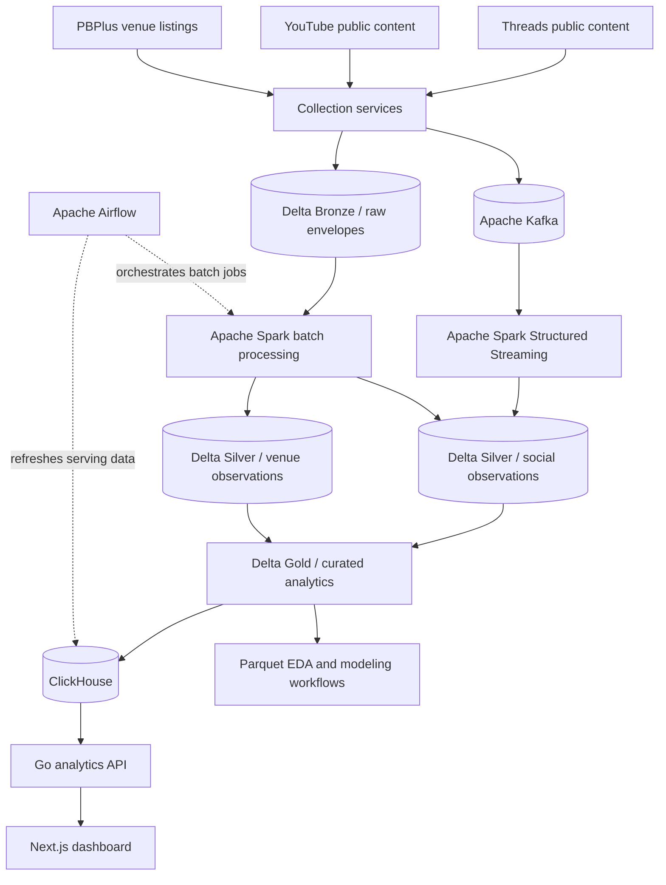

DSP391m — Pickleball Market Intelligence Platform
An end-to-end data engineering and analytics platform for exploring pickleball activity and venue supply in Vietnam.

DSP391m collects public social-content observations and venue listings, processes them with Apache Kafka and Apache Spark, maintains a Delta Lake lakehouse, and serves curated analytics through ClickHouse, a Go API, and a web interface. The repository supports reproducible local replay, bounded live collection, operational monitoring, and batch orchestration.
Interpretation: Social posts and engagement are proxies for public interest and activity, not direct measurements of consumer demand. Locations derived from post text are mentions, not verified author locations. Venue listings represent observed supply from the supported source, not a complete census of all pickleball courts.

Contents
- Project goals
- Architecture
- Data sources and lakehouse layers
- Technology stack
- Repository structure
- Getting started
- Running the local pipeline
- Analytics API, dashboard, and data operations
- Orchestration and EDA
- Research and modeling directions
- Testing and quality checks
- Configuration and data handling
- Documentation
- License
Project goals
1. Collect and consolidate data: Integrate public social-content observations and pickleball venue listings in a reproducible ingestion workflow.
2. Build a maintainable lakehouse: Organize raw, validated, and analytical datasets into Bronze, Silver, and Gold layers with Apache Spark and Delta Lake.
3. Provide analytical visibility: Describe social activity, observed venue supply, and their geographic and temporal distributions.
4. Support local operations: Enable replay, bounded live collection, scheduled batch jobs, monitoring, and reproducible verification.
5. Prepare data for research: Provide curated data and features for clustering, forecasting, and geographic analysis.
Architecture

The supported one-command local E2E pipeline focuses on Threads and PBPlus. The Data Operations workflow additionally supports YouTube collection. These workflows share the core lakehouse and serving components but have distinct operational entry points.

Responsibility by layer:
Layer	Responsibility
Collectors	Acquire source observations and preserve run-scoped artifacts.
Kafka	Transport social events to the streaming pipeline.
Spark	Validate, normalize, merge, aggregate, and build analytical datasets.
Delta Lake	Store canonical Bronze, Silver, and Gold datasets.
ClickHouse	Serve published analytical snapshots and aggregates for efficient querying.
Go backend	Expose analytics, operational status, and collection-control endpoints.
Next.js frontend	Present dashboards and operational controls.
Airflow	Coordinate local batch dependencies and refreshes.

Data sources and lakehouse layers
Sources
Source	Data captured	Use
Threads	Public posts and available engagement metadata	Social activity and text-mentioned geographic interest
YouTube	Public videos, metadata, and supported top-level comments	Additional source-specific activity measures via Data Operations
PBPlus	Observed pickleball venues/court information	Venue supply inventory and geographic aggregation

Medallion architecture
- Bronze: Source-oriented raw envelopes and ingestion history, retained for traceability and replay.
- Silver: Normalized social and court observations with stable identities and source-specific attributes.
- Gold: Curated aggregates and analytical views, including daily social activity, venue supply by location, and a location market-signal snapshot.
The main local ClickHouse-serving workflow publishes the Gold location_market_signal_snapshot. Data Operations also maintains source-specific social activity aggregates. Geographic records with unresolved identity are handled separately rather than assigned to arbitrary locations.
Technology stack
Area	Tools
Data collection	Python, Playwright, HTTP clients, source-specific collectors
Messaging	Apache Kafka
Distributed data processing	PySpark, Spark Structured Streaming
Lakehouse storage	Delta Lake, Parquet
Analytical serving	ClickHouse
Workflow orchestration	Apache Airflow
Backend	Go, Gin
Frontend	Next.js, React, TypeScript, Tailwind CSS
Exploratory analytics	Parquet exports and optional Apache Superset environment
Development and validation	Poetry, Make, Docker Compose, Python tests, Go tests, Playwright
Optional infrastructure	S3A/Databricks integration configuration and related scripts

The local quick start does not require AWS, Databricks, or an Airflow service.
Repository structure
DSP391m/
├── apps/
│   ├── collector/             # Source collection and normalization
│   ├── backend/               # Go API and collection operations
│   └── frontend/              # Web dashboard and data operations UI
├── configs/                   # Runtime, collection, and reference configuration
├── contracts/                 # Shared data contracts
├── docs/                      # Project documentation and EDA assets
├── infra/
│   ├── clickhouse/            # Analytical serving and migrations
│   ├── kafka/                 # Messaging infrastructure
│   ├── superset/              # Optional analytical dashboard environment
│   └── databricks/            # Job packaging and submission utilities
├── orchestration/
│   ├── local/                 # Verified local E2E and data operations
│   └── airflow/               # Local batch DAG and control utilities
├── pipelines/spark/           # Spark ingestion, transformations, and Gold jobs
├── scripts/                   # Supporting scripts
├── tests/                     # Shared tests and replay fixtures
├── docker-compose.yaml
├── Makefile
├── pyproject.toml
└── README.md
Getting started
Requirements
For the Python/Spark local pipeline:
- Python 3.12 and Poetry 2.x
- Java 17 or 21
- Docker Engine and Docker Compose 2.24+
- GNU Make and Git
- Linux/WSL or macOS with access to the Docker daemon
Go and Node.js are needed only when running the API and frontend; follow the versions specified by their respective module/package manifests.
Installation
Run from the repository root:
git clone https://github.com/OiHuecuata/DSP391m.git
cd DSP391m

poetry env use python3.12
make install

cp .env.example .env
export JAVA_HOME=/absolute/path/to/jdk17-or-jdk21
Review .env for your local settings. Do not overwrite an existing .env file containing your configuration.

For browser-based live collection, install the required Chromium runtime:
poetry run playwright install --with-deps chromium
The first run may download Docker images and Spark dependencies.
Running the local pipeline
1. Validate the environment
make pipeline-preflight PIPELINE_MODE=replay \
  THREADS_REPLAY_PATH=tests/fixtures/pipeline/threads.json \
  PBPLUS_REPLAY_PATH=tests/fixtures/pipeline/pbplus.json
2. Run isolated end-to-end acceptance tests
make pipeline-e2e-test
This verifies Kafka, Spark, Delta Lake, and ClickHouse using isolated synthetic fixtures, including repeated replay, empty input, and failure scenarios. It avoids overwriting the normal local pipeline targets.
3. Run the pipeline with saved data
make pipeline-e2e PIPELINE_MODE=replay \
  THREADS_REPLAY_PATH=path/to/threads-bronze.json \
  PBPLUS_REPLAY_PATH=path/to/pbplus-bronze.json
Replay inputs must be saved raw crawler/Bronze envelopes, not normalized Silver files. The pipeline writes to its configured targets; use isolated configuration if you do not want to change an existing local lakehouse or serving snapshot.

To try the committed development fixtures explicitly:
make pipeline-e2e PIPELINE_MODE=replay \
  THREADS_REPLAY_PATH=tests/fixtures/pipeline/threads.json \
  PBPLUS_REPLAY_PATH=tests/fixtures/pipeline/pbplus.json
4. Run bounded live collection
make pipeline-e2e PIPELINE_MODE=live \
  PIPELINE_THREADS_LIMIT=3 \
  PIPELINE_PBPLUS_LIMIT=20
Live mode must not be configured with replay paths. Review source availability, permissions, rate limits, and the detailed runtime instructions before running larger collections.

See the [one-command pipeline guide](orchestration/local/README.md) for configuration precedence, replay semantics, failure handling, verification, and empty-input behavior.
Analytics API, dashboard, and data operations
ClickHouse and API
After producing the relevant Gold tables, run:
make clickhouse-up
make clickhouse-migrate
make load-market-signals-clickhouse
make backend-run
The API is available by default at http://localhost:8080. Example endpoints:
GET /health
GET /api/v1/analytics/location-market-signals
GET /api/v1/system/status
The ClickHouse loader publishes a validated replacement of the current analytical snapshot. See [ClickHouse serving instructions](infra/clickhouse/README.md) and [local smoke evidence](infra/clickhouse/local-smoke.md).
Web frontend
Install its dependencies and launch the development server in separate terminals from the API:
cd apps/frontend
npm install
npm run dev
The frontend includes an application home page and a Data Operations interface at /data-operations (by default, http://localhost:3000/data-operations).
Local Data Operations
Use Data Operations to run or schedule supported source collection and inspect processing status, Delta storage, and ClickHouse serving. Start the supporting services and application:
make kafka-up kafka-topic clickhouse-up
make backend-run
# In another terminal:
make frontend-run
For YouTube collection, configure YOUTUBE_API_KEY as described in [Data Operations documentation](orchestration/local/data_operations.md). Never expose credentials in frontend NEXT_PUBLIC_ variables.
Orchestration and EDA
Airflow batch orchestration
make airflow-up
make airflow-status
make airflow-dag-list
The local Airflow UI defaults to http://localhost:8081. The dsp391m_market_signal_refresh DAG coordinates existing collection/Spark/ClickHouse jobs; it is manual by default. Optional scheduling and run configuration are documented in the [Airflow guide](orchestration/airflow/README.md).
Live accumulation and EDA exports
make collect-live-eda LIVE_EDA_CYCLES=2
make report-live-eda
The collection workflow produces run-scoped artifacts, metrics, and Parquet outputs for exploratory analysis. Read the [live collection instructions](orchestration/local/live_collection.md) for pacing, dataset measurements, backups, and EDA access.

An optional Superset environment is also available through the repository's superset-* Make targets; it is separate from the required local E2E pipeline.
Research and modeling directions
The curated lakehouse provides a foundation for three analytical research tracks:
Research track	Main question	Candidate approach
Interest-pattern clustering	Which locations or periods exhibit similar observed activity patterns?	Feature engineering over Silver/Gold observations followed by clustering benchmarks
Activity trend forecasting	How might the volume of relevant social posts change over time?	Temporal aggregation, time-aware validation, and forecasting model comparisons
Geographic supply–activity analysis	How are observed venue supply and public activity signals distributed across locations?	Geographical aggregation, maps, and comparative visualizations

These are research objectives, not claims that production ML training or model serving is part of the one-command pipeline. Forecasting social-post counts predicts an observed activity proxy, not actual bookings or latent consumer demand. Research experiments should retain source, geography, and temporal limitations in their interpretation.
Testing and quality checks
Useful project commands:
Command	Purpose
make pipeline-e2e-test	Isolated integration/acceptance scenarios
make spark-test	Spark and Delta transformation tests
make smoke-clickhouse	Gold-to-ClickHouse and API smoke checks
make backend-test	Go backend unit tests
make backend-vet	Go static analysis
make frontend-lint	Frontend lint checks
make frontend-test	Frontend browser tests (requires its dependencies)
make airflow-test	Airflow DAG tests
make lint	Python lint and formatting checks

Review the Makefile for the complete list of supported targets. Prefer isolated verification before running commands against shared local datasets.
Configuration and data handling
- Configure environment values through .env or exported variables; see .env.example.
- Do not commit API keys, passwords, local credentials, raw private artifacts, or generated runtime state.
- Keep replay inputs and analytical snapshot dates explicit when applicable.
- Run coordinated writers when multiple workflows share the same lakehouse or ClickHouse targets; independent concurrent writes are not automatically safe.
- Treat public social-content geography as text-mentioned geography. Preserve null and unknown observations instead of inventing locations or demand values.
- Local operation is the default. S3A/Databricks-related configuration and tooling do not make cloud services prerequisites for local testing.
Documentation
Guide	What it covers
[Local one-command E2E](orchestration/local/README.md)	Setup, replay/live modes, verification, and configuration
[Live collection and EDA](orchestration/local/live_collection.md)	Paced accumulation, metrics, backups, and Parquet exports
[Local Data Operations](orchestration/local/data_operations.md)	Collection scheduling, source controls, and observability
[ClickHouse serving](infra/clickhouse/README.md)	Gold publication, SQL, API, and validation
[Executed ClickHouse smoke](infra/clickhouse/local-smoke.md)	Local serving verification evidence
[Airflow orchestration](orchestration/airflow/README.md)	Batch DAG, scheduling, and local runtime

License
This repository is licensed under the GNU General Public License v3.0 (GPL-3.0). See LICENSE.
