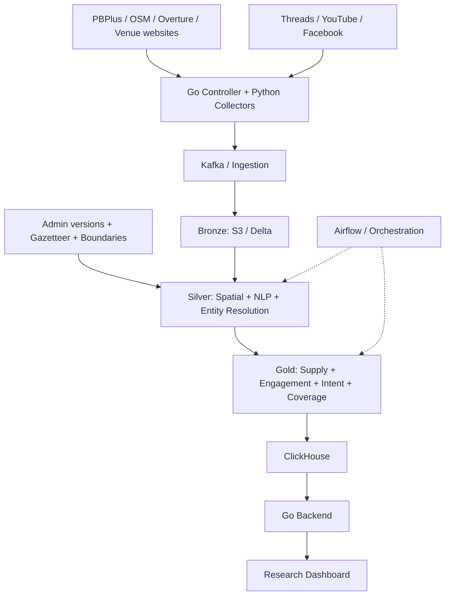
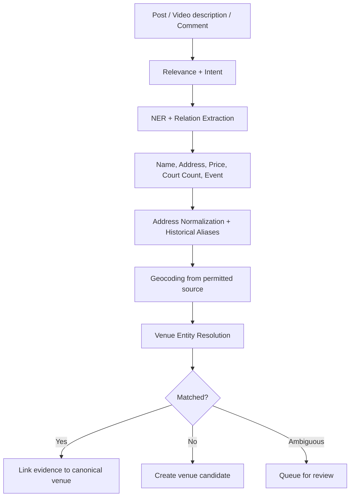

# DSP391m — Data Requirements v1.0

> **Dự án:** National Pickleball Market Intelligence Platform  
> **Ngày:** 2026-10-08  
> **Trạng thái:** Bản đề xuất yêu cầu dữ liệu hợp nhất  
> **Phạm vi:** Việt Nam; Descriptive Analytics & Diagnostic Analytics  
> **Nơi lưu đề xuất trong repository:** `docs/data/DSP391m_Data_Requirements_v1.0.md`

## Mục lục

1. [Mục tiêu và phạm vi nghiên cứu](#1-mục-tiêu-và-phạm-vi-nghiên-cứu)
2. [Nguồn dữ liệu](#2-nguồn-dữ-liệu)
3. [Kiến trúc dữ liệu](#3-kiến-trúc-dữ-liệu)
4. [Bronze Layer — Data Requirements](#4-bronze-layer--data-requirements)
5. [Silver Layer — Data Requirements](#5-silver-layer--data-requirements)
6. [Gold Layer — Analytical Requirements](#6-gold-layer--analytical-requirements)
7. [Trích xuất feature từ Bronze sang Silver và Gold](#7-trích-xuất-feature-từ-bronze-sang-silver-và-gold)
8. [Dual Geography — Hai hệ thống hành chính](#8-dual-geography--hai-hệ-thống-hành-chính)
9. [Cloud Data Collection](#9-cloud-data-collection)
10. [Data Quality, quyền sử dụng và độ bao phủ](#10-data-quality-quyền-sử-dụng-và-độ-bao-phủ)
11. [Lộ trình ưu tiên triển khai](#11-lộ-trình-ưu-tiên-triển-khai)
12. [Acceptance Criteria](#12-acceptance-criteria)
13. [Dashboard tối thiểu](#13-dashboard-tối-thiểu)
14. [Các quyết định kiến trúc](#14-các-quyết-định-kiến-trúc)
15. [Nguồn tham khảo và lưu ý kiểm chứng](#15-nguồn-tham-khảo-và-lưu-ý-kiểm-chứng)

---

## 1. Mục tiêu và phạm vi nghiên cứu

### 1.1. Mục tiêu

Xây dựng hệ thống **tự động thu thập, chuẩn hóa, tích hợp và phân tích dữ liệu thị trường Pickleball trên toàn Việt Nam**. Trọng tâm hiện tại là mô tả hiện trạng và phân tích nguyên nhân (Descriptive & Diagnostic Analytics), chưa triển khai dự báo nhu cầu thực tế.

Hệ thống nghiên cứu **bốn nhóm dữ liệu liên kết**:

| Nhóm | Nội dung | Giá trị phân tích |
|---|---|---|
| **Court Supply** | Địa điểm, số lượng cơ sở/sân, giá, quy mô, tiện ích, tình trạng hoạt động | Cung sân được quan sát theo địa phương và thời gian |
| **Social Engagement** | Bài đăng, video, lượt xem, thích, bình luận, chia sẻ, tốc độ tăng tương tác | Mức độ quan tâm và thảo luận trực tuyến |
| **Social Intent** | Tìm sân, đặt sân, hỏi giá, tìm người chơi, phản ánh thiếu sân | Tín hiệu quan tâm và ý định, **không phải số giao dịch** |
| **Geographic & Temporal Intelligence** | Địa chỉ, tọa độ, địa giới cũ/mới, tên địa danh, thời điểm | So sánh không gian và xu hướng qua thời gian |

### 1.2. Câu hỏi nghiên cứu

| Nhóm | Câu hỏi |
|---|---|
| Supply | Có bao nhiêu cơ sở, bao nhiêu sân đã được ghi nhận ở mỗi địa phương? |
| Supply | Mức giá, quy mô và tiện ích khác nhau thế nào? |
| Supply | Cơ sở nào mới phát hiện, khai trương hoặc ngừng hoạt động? |
| Engagement | Nền tảng, khu vực, loại nội dung nào có nhiều tương tác? |
| Engagement | Views/likes/comments/shares thay đổi thế nào theo thời gian? |
| Intent | Người dùng đang tìm sân, tìm người chơi hoặc hỏi giá ở đâu? |
| Intent | Những vấn đề nào được nhắc nhiều: kín sân, giá cao, chất lượng kém...? |
| Geography | Có thể phân tích theo địa giới trước/sau năm 2025 không? |
| Geography | Tên địa phương cũ còn được dùng như thế nào sau sáp nhập? |
| Diagnostic | Yếu tố nội dung/sự kiện nào đi kèm các đợt tăng hoạt động? |
| Supply–Social | Nơi nào có nhiều tín hiệu tìm sân nhưng ít cung được ghi nhận? |
| Quality | Độ bao phủ và độ tin cậy của từng kết quả là bao nhiêu? |

### 1.3. Nguyên tắc diễn giải

- **Observed Supply:** số sân/cơ sở đã tìm được trong phạm vi dữ liệu; không đồng nghĩa tổng số thực tế.
- **Social Engagement:** sự chú ý/tương tác với nội dung; không được coi là nhu cầu thuê sân.
- **Demand Signals:** biểu hiện tìm sân, hỏi giá, đặt lịch, tìm người chơi, phàn nàn kín sân...; chưa phải hành vi mua/đặt thực tế.
- **Actual Demand:** cần dữ liệu đặt sân, giờ sử dụng, khảo sát hoặc nguồn đo thực tế đáng tin cậy.
- Không có bản ghi không có nghĩa không có sân hoặc không có người chơi.
- Mỗi chỉ số phải có **grain, phạm vi nguồn, kỳ quan sát, công thức, độ bao phủ và lineage**.

---

## 2. Nguồn dữ liệu

### 2.1. Nguồn sân — Multi-source Venue Discovery

| Nguồn | Dữ liệu mục tiêu | Vai trò | Ưu tiên |
|---|---|---|---|
| PBPlus | Tên cơ sở, địa chỉ, số sân, giá, tiện ích nếu có | Nguồn đã triển khai | **P0** |
| OpenStreetMap (OSM) | Địa điểm thể thao, nhãn Pickleball, địa chỉ, tọa độ | Nguồn POI mở, phát hiện/đối chiếu | **P0** |
| Overture Maps | POI, tên, địa chỉ, tọa độ (nếu có) | Mở rộng danh mục địa điểm | P1 |
| Threads | Bài giới thiệu, quảng cáo, khai trương, đóng sân | Bằng chứng/ứng viên từ text | **P0** |
| YouTube | Tiêu đề, mô tả video, nội dung bình luận | Bằng chứng/ứng viên từ text | **P0** |
| Facebook | Page/Group có quyền truy cập hợp lệ | Bằng chứng về sân và sự kiện | P1 |
| Google Places API | Place ID và thông tin được phép truy cập | Tra cứu/đối chiếu, có giới hạn lưu trữ | P1 |
| Website chính thức của sân | Địa chỉ, quy mô, giá, giờ hoạt động, dịch vụ | Bổ sung và xác minh | P1 |
| Đối tác/khảo sát | Giờ thuê, tình trạng sử dụng, giao dịch | Xác thực và nghiên cứu sâu | P2 |

**Yêu cầu:** Không xây danh mục sân duy nhất từ PBPlus. Sân mới phải có thể được phát hiện từ **bài đăng/bình luận/video**, chuẩn hóa địa chỉ, định vị và gộp với những cơ sở đã biết.

**Google Maps:** API Places có thể tra cứu địa điểm nhưng chính sách hạn chế scraping, cache/lưu trữ và tạo bộ dữ liệu độc lập từ nội dung Google Maps; `place_id` có ngoại lệ nhất định. Không mặc định lưu vĩnh viễn dữ liệu tên/địa chỉ/tọa độ lấy từ Places vào Silver/Gold. Khi cần lưu tọa độ lâu dài, ưu tiên dữ liệu mở hoặc dữ liệu được cấp phép phù hợp. Đối chiếu chính sách hiện hành trước khi tích hợp.

### 2.2. Nguồn Social Engagement & Intent

| Nguồn | Nội dung | Tương tác mục tiêu | Bình luận/trả lời | Ưu tiên |
|---|---|---|---|---|
| Threads | Bài viết và reply được phép truy cập | Like, reply, repost, quote, insights theo quyền | Theo quyền API | **P0** |
| YouTube | Video, tiêu đề, mô tả | View, like, comment count | Comment threads/replies | **P0** |
| Facebook | Page/Group được cho phép | Reaction, comment, share tùy quyền | Theo quyền API | P1 |
| TikTok | Video, mô tả | Theo API được cấp quyền | Theo API được cấp quyền | P2 |
| Google Trends | Chỉ số quan tâm tìm kiếm chuẩn hóa | Không áp dụng | Không áp dụng | P2 |

**Functional requirements nguồn xã hội**

- **SRC-01:** Thu bài đăng/video riêng với bình luận/reply; không chỉ lấy `comment_count`.
- **SRC-02:** Thu các chỉ số tương tác khi nền tảng hỗ trợ và cập nhật chúng ở các mốc quan sát mới.
- **SRC-03:** Mỗi bình luận được phân tích độc lập về địa điểm, cơ sở, chủ đề, cảm xúc và intent.
- **SRC-04:** Không mặc định mọi nguồn hỗ trợ mọi metric; thiếu dữ liệu là `null` và phải lưu trạng thái khả dụng.
- **SRC-05:** Có query registry, collection logs, quota control, checkpoint và backfill khi API cho phép.
- **SRC-06:** Không coi số bài chứa từ khóa “tìm sân” là *search volume* của nền tảng. Chỉ gọi *search volume* khi có dữ liệu số lượt tìm kiếm thực sự.

### 2.3. Dữ liệu hành chính, địa lý và bổ trợ

| Nguồn | Yêu cầu |
|---|---|
| Danh mục hành chính trước 01/07/2025 | 63 tỉnh/thành, các cấp huyện và xã theo phiên bản thời kỳ |
| Danh mục từ 01/07/2025 | 34 tỉnh/thành và danh mục cấp xã có hiệu lực (3.321 đơn vị theo danh mục năm 2025) |
| Crosswalk hành chính | Ánh xạ sáp nhập, chia tách, điều chỉnh địa giới, đổi tên |
| Geo boundaries | Polygon/multipolygon, centroid, code, version, validity |
| Gazetteer + OSM/Overture POIs | Tên địa điểm, alias, tọa độ, địa chỉ |
| Dân số, diện tích | Chuẩn hóa khi so sánh địa phương |
| Source coverage history | Lịch sử truy vấn thành công/thất bại, phạm vi nguồn |

Không giả định địa giới hành chính bất biến trong toàn bộ chuỗi thời gian.

---

## 3. Kiến trúc dữ liệu

### 3.1. Luồng tổng thể



### 3.2. Trách nhiệm các thành phần

| Thành phần | Trách nhiệm |
|---|---|
| Go Controller | Kế hoạch thu thập, chia query, quản lý job, quota, checkpoint, trạng thái |
| Python Collectors | Thu thập theo API/nguồn được phép, sinh raw observation envelope |
| Kafka | Truyền bản ghi/event bất đồng bộ, hỗ trợ retry |
| Bronze Writer | Ghi đúng dữ liệu được phép lưu xuống S3/Bronze |
| S3 / Delta | Lưu quan sát nguồn, metadata theo retention contract |
| Spark / Databricks | Validate, normalize, NLP, geocoding, entity matching và aggregate |
| Airflow | Điều phối công việc xử lý Bronze → Silver → Gold; kiểm thử chất lượng |
| ClickHouse | Phục vụ truy vấn Gold cho dashboard |
| Go Backend | API truy vấn, phân tích, trạng thái hệ thống |

**Không được có thành phần bắt buộc nào chỉ chạy trên laptop.** Go Controller điều phối **collection**; Airflow điều phối **analytical processing**; không để hai hệ thống đồng thời ghi cùng một bảng Gold.

---

## 4. Bronze Layer — Data Requirements

### 4.1. Quy tắc

Bronze ghi nhận raw observations đủ để có thể xử lý lại, nhưng **chỉ trong phạm vi và thời hạn dữ liệu được phép lưu**. Phân biệt một thực thể nguồn với **một lần quan sát** của thực thể đó.

**Envelope chung:**

| Field | Type | Ý nghĩa |
|---|---|---|
| `source_platform` | STRING | PBPlus, OSM, Threads, YouTube... |
| `source_record_id` | STRING | ID nguồn, trong namespace nền tảng |
| `record_type` | STRING | Venue/Post/Video/Comment/Metric/Run |
| `source_url` | STRING | URL dẫn tới nội dung nếu có |
| `collected_at` | TIMESTAMP | Thời điểm thu được |
| `source_created_at` | TIMESTAMP | Thời điểm tạo ở nguồn nếu có |
| `source_updated_at` | TIMESTAMP | Thời điểm cập nhật tại nguồn nếu có |
| `collection_run_id` | STRING | Phiên thu thập |
| `query_id` | STRING | Truy vấn dùng để phát hiện |
| `raw_payload` | JSON/STRING | Dữ liệu nguồn **được phép** lưu |
| `payload_hash` | STRING | Phát hiện thay đổi |
| `schema_version` | STRING | Phiên bản contract |
| `retention_policy_id` | STRING | Quy định lưu trữ theo nguồn |
| `retention_expires_at` | TIMESTAMP | Thời điểm xóa/làm mới khi áp dụng |

**Không lưu** token, password, cookie đăng nhập hay thông tin xác thực trong Bronze.

### 4.2. Các bảng Bronze

| Table | Grain | Nội dung |
|---|---|---|
| `bronze_court_observations` | Source venue × lần quan sát | Thông tin cơ sở |
| `bronze_social_posts` | Source post/video × lần thu | Text, mô tả, metadata |
| `bronze_social_comments` | Source comment/reply × lần thu | Nội dung, phân cấp thảo luận |
| `bronze_engagement_snapshots` | Nội dung × thời điểm đo | Các bộ đếm tương tác |
| `bronze_collection_runs` | Collection run/query | Trạng thái, quota, số bản ghi, lỗi |
| `bronze_source_changes` | Sự kiện thay đổi/xóa nguồn | Phục vụ lifecycle và chính sách dữ liệu |

### 4.3. `bronze_court_observations`

| Feature | Type | Ưu tiên |
|---|---|---|
| `source_venue_id` | STRING | P0 |
| `venue_name_raw` | STRING | P0 |
| `address_raw` | STRING | P0 |
| `latitude_raw`, `longitude_raw` | DOUBLE | P0 nếu có |
| `court_count_raw` | STRING | P0 |
| `price_raw` | STRING | P1 |
| `amenities_raw` | JSON | P1 |
| `opening_hours_raw` | STRING | P1 |
| `venue_status_raw` | STRING | P1 |
| `description_raw` | STRING | P0 nếu có |

Ứng viên sân trích từ social text phải có `source_record_id` và bằng chứng gốc; không dựng payload giả thành bản ghi PBPlus.

### 4.4. `bronze_social_posts`

| Feature | Type |
|---|---|
| `native_post_id` | STRING |
| `content_type` | STRING |
| `parent_content_id` | STRING |
| `title_raw` | STRING |
| `text_raw` | STRING |
| `description_raw` | STRING |
| `published_at` | TIMESTAMP |
| `language_raw` | STRING |
| `source_permalink` | STRING |

### 4.5. `bronze_social_comments`

| Feature | Type |
|---|---|
| `native_comment_id` | STRING |
| `native_post_id` | STRING |
| `parent_comment_id` | STRING |
| `comment_text_raw` | STRING |
| `published_at` | TIMESTAMP |
| `updated_at` | TIMESTAMP |
| `is_reply` | BOOLEAN |

### 4.6. `bronze_engagement_snapshots`

| Feature | Type |
|---|---|
| `native_content_id` | STRING |
| `content_type` | STRING |
| `observed_at` | TIMESTAMP |
| `view_count` | BIGINT |
| `like_count` | BIGINT |
| `comment_count` | BIGINT |
| `share_count` | BIGINT |
| `repost_count` | BIGINT |
| `quote_count` | BIGINT |
| `reply_count` | BIGINT |
| `metric_scope` | STRING |
| `metric_availability` | JSON |

**Quy tắc:** Bộ đếm là số tích lũy ở một thời điểm. Không cộng các snapshot như cộng số sự kiện. Một video có 1.000 → 3.000 → 5.000 views không có nghĩa có 9.000 views.

---

## 5. Silver Layer — Data Requirements

Silver chuyển nguồn thô thành thực thể, quan hệ, địa điểm, ý định và snapshot chuẩn hóa. Các kiểu dưới đây là **contract mục tiêu v3**, không phải khẳng định tất cả đã có trong repository.

### 5.1. `silver_venue_candidates`

**Grain:** một ứng viên cơ sở từ một bằng chứng hoặc một nhóm bằng chứng có liên quan.

| Feature | Type | Bronze → Silver |
|---|---|---|
| `candidate_id` | STRING | Sinh ID ổn định từ bằng chứng |
| `venue_name` | STRING | Normalize tên cơ sở |
| `address_text` | STRING | Trích địa chỉ nguồn/text |
| `latitude`, `longitude` | DOUBLE | Định vị nếu đủ chính xác và được phép lưu |
| `geocoding_precision` | STRING | POI / STREET / ADMIN / UNRESOLVED |
| `court_count` | INTEGER | Parse có kiểm tra ngữ cảnh |
| `price_min_vnd`, `price_max_vnd` | DECIMAL | Chuẩn hóa giá |
| `price_unit` | STRING | Ví dụ VND_PER_COURT_HOUR |
| `venue_status` | STRING | Active / Closed / Unknown |
| `source_platform` | STRING | Nguồn phát hiện |
| `evidence_id` | STRING | Khóa bằng chứng |
| `discovered_at` | TIMESTAMP | Lần đầu được quan sát |
| `match_status` | STRING | New / Matched / Ambiguous |
| `verification_status` | STRING | Verified / Probable / Unverified |
| `confidence_score` | DOUBLE | Điểm tin cậy theo quy tắc |

Ứng viên chưa xác minh **không** được tự động cộng vào thống kê nguồn cung xác minh.

### 5.2. `silver_court_venues`

**Grain:** một cơ sở vật lý đã được định danh (`venue_id`). Một cơ sở có 6 sân tương ứng **1 venue và 6 courts** (nếu số sân đã biết).

| Feature | Type | Ý nghĩa |
|---|---|---|
| `venue_id` | STRING | Định danh canonical |
| `venue_name` | STRING | Tên chuẩn |
| `address_normalized` | STRING | Địa chỉ chuẩn hóa |
| `latitude`, `longitude` | DOUBLE | Tọa độ có provenance |
| `old_province_id` | STRING | Tỉnh theo địa giới cũ |
| `old_district_id` | STRING | Quận/huyện cũ |
| `old_ward_id` | STRING | Xã/phường cũ |
| `new_province_id` | STRING | Tỉnh/thành mới |
| `new_ward_id` | STRING | Xã/phường mới |
| `court_count` | INTEGER | Số sân đã biết |
| `court_count_status` | STRING | Known / Unknown / Conflicting |
| `price_min_vnd`, `price_max_vnd` | DECIMAL | Giá chuẩn hóa |
| `is_indoor` | BOOLEAN | Có sân trong nhà, null nếu chưa biết |
| `has_lighting` | BOOLEAN | Có đèn, null nếu chưa biết |
| `has_parking` | BOOLEAN | Có bãi xe, null nếu chưa biết |
| `verification_status` | STRING | Trạng thái xác minh |
| `first_seen_at`, `last_seen_at` | TIMESTAMP | Khoảng quan sát |
| `source_count` | INTEGER | Số nguồn độc lập đóng góp bằng chứng |

Nếu không có chứng cứ cho từng sân vật lý, chưa cần tạo `silver_courts` riêng.

### 5.3. `silver_social_posts`

| Feature | Type | Phương pháp |
|---|---|---|
| `post_id` | STRING | Platform + native_post_id |
| `platform` | STRING | Chuẩn nguồn |
| `content_type` | STRING | Post / Video / Thread |
| `parent_post_id` | STRING | Quan hệ nội dung |
| `text_normalized` | STRING | Text cleaning |
| `published_at` | TIMESTAMP | UTC |
| `published_date_vn` | DATE | Asia/Ho_Chi_Minh |
| `language` | STRING | Nhận diện ngôn ngữ |
| `is_pickleball_related` | BOOLEAN | Relevance classifier |
| `is_commercial` | BOOLEAN | Phân loại thương mại/quảng cáo |
| `intent_labels` | ARRAY<STRING> | Multi-label classification |
| `topic_labels` | ARRAY<STRING> | Topic classification |
| `sentiment` | STRING | Positive/Neutral/Negative/Mixed |
| `relevance_confidence` | DOUBLE | Confidence |
| `is_duplicate` | BOOLEAN | Exact/near-duplicate detection |

### 5.4. `silver_social_comments`

| Feature | Type | Phương pháp |
|---|---|---|
| `comment_id` | STRING | Platform + native_comment_id |
| `post_id` | STRING | Bài/video chứa bình luận |
| `parent_comment_id` | STRING | Bình luận cha |
| `comment_text_normalized` | STRING | Text cleaning |
| `published_at` | TIMESTAMP | UTC |
| `is_reply` | BOOLEAN | Phân cấp thảo luận |
| `is_pickleball_related` | BOOLEAN | Relevance classification |
| `intent_labels` | ARRAY<STRING> | Multi-label intent |
| `topic_labels` | ARRAY<STRING> | Topic extraction |
| `sentiment` | STRING | Sentiment classification |
| `mentioned_venue_ids` | ARRAY<STRING> | Entity linking |
| `classification_confidence` | DOUBLE | Confidence |

**Không gán địa phương của video/bài gốc cho comment một cách mặc định.** Mỗi comment có thể chứa location/intent riêng.

### 5.5. `silver_social_engagement_snapshots`

| Feature | Type |
|---|---|
| `content_id` | STRING |
| `content_type` | STRING |
| `platform` | STRING |
| `observed_at` | TIMESTAMP |
| `views`, `likes`, `comments`, `shares` | BIGINT, nullable |
| `reposts`, `quotes` | BIGINT, nullable |
| `content_age_hours` | DOUBLE |
| `engagement_total` | BIGINT, nullable |
| `engagement_rate` | DOUBLE, nullable |
| `engagement_rate_basis` | STRING |
| `metrics_available` | ARRAY<STRING> |
| `snapshot_status` | STRING |

`engagement_total` và `engagement_rate` chỉ tính khi **định nghĩa và mẫu số của nền tảng** được xác nhận, không cộng thiếu trường thành 0.

### 5.6. Bộ nhãn `intent_type`

| Nhãn | Ý nghĩa | Ví dụ |
|---|---|---|
| `SEEK_COURT` | Tìm sân | “Có sân nào trống ở Huế không?” |
| `BOOKING_INTENT` | Có ý định đặt sân | “Cần đặt sân tối mai” |
| `SEEK_PLAYERS` | Tìm người chơi | “Cần thêm 2 người ghép kèo” |
| `SEEK_COACH` | Tìm lớp/huấn luyện viên | “Ở đâu có lớp cơ bản?” |
| `PRICE_INQUIRY` | Hỏi giá | “Một giờ thuê bao nhiêu?” |
| `CAPACITY_COMPLAINT` | Phản ánh thiếu chỗ chơi | “Cuối tuần sân nào cũng kín” |
| `VENUE_FEEDBACK` | Nhận xét về sân | “Mặt sân trơn, đèn tối” |
| `SUPPLY_ADVERTISEMENT` | Quảng cáo sân | “Sân ABC nhận đặt lịch” |
| `SUPPLY_OPENING` | Khai trương sân | “Mở thêm 6 sân mới” |
| `SUPPLY_CLOSURE` | Ngừng hoạt động | “Sân đã ngừng kinh doanh” |
| `EVENT_TOURNAMENT` | Sự kiện/giải đấu | “Giải giao hữu cuối tuần” |
| `GENERAL_DISCUSSION` | Thảo luận chung | “Pickleball khó chơi không?” |
| `IRRELEVANT` | Không liên quan | Nội dung ngoài phạm vi |

Cho phép **multi-label**: một nội dung có thể vừa tìm sân vừa hỏi giá. Nhóm quảng cáo nguồn cung **không** được tính là nhu cầu tìm sân.

### 5.7. `silver_social_geo_mentions`

**Grain:** một lần nhắc địa điểm/địa chỉ gắn với một nội dung và vai trò ngữ nghĩa.

| Feature | Type | Ý nghĩa |
|---|---|---|
| `mention_id` | STRING | ID mention |
| `content_id` | STRING | Post/comment nguồn |
| `content_type` | STRING | Post/Comment |
| `location_text_raw` | STRING | Văn bản địa danh |
| `address_text_raw` | STRING | Địa chỉ được trích |
| `location_role` | STRING | Nơi tìm sân / nơi tổ chức / nơi quảng cáo... |
| `old_province_id`, `old_district_id`, `old_ward_id` | STRING | Hệ hành chính cũ |
| `new_province_id`, `new_ward_id` | STRING | Hệ mới |
| `latitude`, `longitude` | DOUBLE, nullable | Vị trí nếu phân giải đủ chính xác |
| `resolution_precision` | STRING | POI / STREET / WARD / PROVINCE / UNRESOLVED |
| `resolution_status` | STRING | Resolved / Ambiguous / Unresolved |
| `confidence` | DOUBLE | Độ tin cậy |
| `evidence_span` | STRING | Trích đoạn làm bằng chứng |
| `extraction_method` | STRING | Rule / NER / Model / Manual |

### 5.8. Các bảng hỗ trợ Silver

| Table | Vai trò |
|---|---|
| `silver_venue_evidence` | Bằng chứng tên sân, số sân, địa chỉ, giá, mở/đóng |
| `silver_venue_source_links` | Mapping nhiều source IDs vào một `venue_id` |
| `silver_geocoding_attempts` | Query, provider, candidate, precision, trạng thái, nguồn tọa độ |
| `silver_social_intent_evidence` | Nội dung → intent → địa phương → evidence span |
| `dim_admin_unit` | Mã/tên/ranh giới đơn vị hành chính theo phiên bản |
| `bridge_admin_crosswalk` | Ánh xạ đơn vị hành chính cũ–mới |
| `dim_location_alias` | Tên chính thức, tên cũ, tên viết tắt, tên phổ biến |

#### `silver_social_intent_evidence` — Feature mở rộng

| Feature | Type |
|---|---|
| `content_id` | STRING |
| `intent_type` | STRING |
| `participant_count_mentioned` | INTEGER |
| `requested_duration_minutes` | INTEGER |
| `requested_start_time` | TIMESTAMP, nullable |
| `requested_time_precision` | STRING |
| `price_budget_min_vnd`, `price_budget_max_vnd` | DECIMAL, nullable |
| `intent_location_id` | STRING |
| `evidence_span` | STRING |
| `confidence` | DOUBLE |

Không suy ra giờ/ngày chính xác từ “thứ bảy” nếu thiếu thời điểm đăng hoặc bối cảnh liên quan.

---

## 6. Gold Layer — Analytical Requirements

### 6.1. Nguyên tắc

- Gold thống kê theo **grain** được khai báo, không gộp sai dữ liệu bài đăng/bình luận hoặc nhiều nguồn.
- Đếm nội dung bằng `COUNT(DISTINCT content_id)` trong phạm vi phù hợp.
- Nội dung multi-label có thể xuất hiện trong nhiều nhóm intent; **tổng nhóm không bằng tổng nội dung duy nhất**.
- Số liệu engagement tích lũy phải chọn **một snapshot chuẩn** trước khi tổng hợp.
- Khi một bài nhắc nhiều địa điểm, cần thể hiện rõ đó là **mention-level** hay **unique-content-level**; không cộng chồng giữa các địa phương để khẳng định tổng bài toàn quốc.
- Supply `as_of` là snapshot, còn hoạt động xã hội là dòng sự kiện theo ngày/tuần/tháng.
- Mọi tỷ lệ đều có mẫu số, số bản ghi đủ điều kiện và trạng thái thiếu dữ liệu.

### 6.2. Danh mục Gold Tables

| Gold table | Grain | Vai trò | Ưu tiên |
|---|---|---|---|
| `court_supply_by_location` | Location × snapshot | Supply hiện tại | **Giữ v1** |
| `social_activity_daily` | Location × day | Hoạt động xã hội | **Giữ v1** |
| `location_market_signal_snapshot` | Location × snapshot | Ghép Supply & Social | **Giữ v1** |
| `court_supply_by_admin_version_v2` | Location × admin version × snapshot | Supply theo hệ hành chính | P0 |
| `social_engagement_daily_v1` | Location × platform × day | Views/likes/comments/shares | P0 |
| `social_intent_daily_v2` | Location × platform × day × intent | Intent trong bài/bình luận | P0 |
| `social_comment_analytics_daily_v1` | Location × platform × day | Thảo luận/feedback | P0 |
| `social_activity_by_admin_version_daily` | Location × admin version × day | Hoạt động theo địa giới | P0 |
| `national_location_coverage_v1` | Location × source × period | Độ bao phủ | P0 |
| `venue_community_feedback_weekly_v1` | Venue × week | Phản hồi theo sân | P1 |
| `location_term_usage_monthly_v1` | Location × term × platform × month | Tên địa danh cũ/mới | P1 |
| `venue_discovery_trends_v1` | Location × month | Phát hiện sân | P1 |
| `location_market_research_monthly_v1` | Location × month | Dashboard tích hợp | P1 |

**Tương thích:** Không làm vỡ contract `location_market_signal_snapshot` v1 đang hoạt động. Giữ rolling-window 30 ngày mặc định và logic snapshot hiện hành; bổ sung Gold v2 song song.

### 6.3. `court_supply_by_admin_version_v2`

| Feature | Type | Cách tính |
|---|---|---|
| `snapshot_date` | DATE | Ngày chốt dữ liệu |
| `admin_version` | STRING | PRE_2025 / POST_2025 |
| `admin_unit_id` | STRING | Địa phương canonical |
| `venue_count` | BIGINT | DISTINCT venue_id đủ điều kiện |
| `known_court_count` | BIGINT | SUM(court_count) trên cơ sở có số sân đã biết |
| `known_count_venue_count` | BIGINT | Số cơ sở có số sân hợp lệ |
| `court_count_coverage_rate` | DOUBLE | known_count_venue_count / venue_count |
| `verified_venue_count` | BIGINT | Số cơ sở verified |
| `probable_venue_count` | BIGINT | Số cơ sở probable |
| `price_min_vnd` | DECIMAL | Min giá có cùng unit |
| `price_median_vnd` | DECIMAL | Median giá hợp lệ |
| `priced_venue_count` | BIGINT | Số cơ sở có giá |
| `venue_last_observed_at` | TIMESTAMP | Freshness |
| `generated_at` | TIMESTAMP | Thời điểm tạo Gold |

Nếu `court_count` thiếu, không mặc định `1`.

### 6.4. `social_engagement_daily_v1`

| Feature | Type | Quy tắc |
|---|---|---|
| `activity_date` | DATE | Ngày đăng theo Việt Nam |
| `admin_version` | STRING | Phiên bản hành chính |
| `admin_unit_id` | STRING | Địa phương được nhắc đến |
| `platform` | STRING | Nguồn |
| `post_count` | BIGINT | Bài/video riêng biệt |
| `total_views` | BIGINT | Views từ snapshot chuẩn, chỉ các bản ghi có dữ liệu |
| `total_likes` | BIGINT | Tương tự |
| `total_comments_reported` | BIGINT | Tổng comment do nguồn báo cáo |
| `total_shares` | BIGINT | Tổng shares nếu được cung cấp |
| `avg_likes_per_post` | DOUBLE | Likes / bài có like metric |
| `avg_comments_per_post` | DOUBLE | Comments / bài có comment metric |
| `median_engagement` | DOUBLE | Trung vị theo định nghĩa nguồn |
| `high_engagement_post_count` | BIGINT | Vượt ngưỡng riêng mỗi nền tảng |
| `posts_with_metrics_count` | BIGINT | Số bài đủ metrics |
| `snapshot_as_of` | TIMESTAMP | Mốc đo |
| `metric_window` | STRING | Latest / First72H / FixedAge... |

Công thức tỷ lệ tham khảo **khi cả tử và mẫu đều khả dụng**:

\[
\operatorname{EngagementRate}_{views} = \frac{Likes+Comments+Shares}{Views}
\]

Không dùng một định nghĩa cross-platform duy nhất khi các metric có semantics khác nhau.

### 6.5. `social_intent_daily_v2`

| Feature | Type | Ý nghĩa |
|---|---|---|
| `activity_date` | DATE | Ngày đăng |
| `admin_unit_id`, `admin_version` | STRING | Địa lý |
| `platform` | STRING | Nguồn |
| `intent_type` | STRING | Loại ý định |
| `post_count` | BIGINT | DISTINCT bài có intent |
| `comment_count` | BIGINT | DISTINCT bình luận có intent |
| `reply_count` | BIGINT | DISTINCT reply có intent |
| `evidence_count` | BIGINT | Số evidence hợp lệ |
| `resolved_content_count` | BIGINT | Nội dung đã gán địa phương |
| `high_confidence_count` | BIGINT | Nội dung qua ngưỡng confidence |
| `generated_at` | TIMESTAMP | Thời điểm tạo |

**Ví dụ:** `court_seeking_post_count` theo địa phương lấy `COUNT(DISTINCT post_id)` sau khi filter `SEEK_COURT` và join mention/location đủ tin cậy.

### 6.6. `social_comment_analytics_daily_v1`

| Feature | Type |
|---|---|
| `activity_date` | DATE |
| `platform`, `admin_unit_id`, `admin_version` | STRING |
| `collected_comment_count` | BIGINT |
| `reported_comment_count` | BIGINT, nullable |
| `relevant_comment_count` | BIGINT |
| `positive_comment_count`, `negative_comment_count`, `neutral_comment_count` | BIGINT |
| `court_seeking_comment_count` | BIGINT |
| `booking_intent_comment_count` | BIGINT |
| `price_inquiry_comment_count` | BIGINT |
| `capacity_complaint_count` | BIGINT |
| `comments_with_resolved_geo` | BIGINT |
| `source_collection_status` | STRING |

\[
\operatorname{CourtSeekingCommentShare} = \frac{court\_seeking\_comment\_count}{relevant\_comment\_count}
\]

`reported_comment_count` ở cấp video có thể không thể phân bổ vào địa phương của comment: **chỉ tính khi cùng phạm vi địa lý/mẫu nguồn**, nếu không giữ nullable và báo cáo ngoài bảng này. Không coi tỷ lệ thu comment là chính xác khi có nội dung ẩn, xóa hoặc trang chưa thu đủ.

### 6.7. `venue_community_feedback_weekly_v1`

| Feature | Ý nghĩa |
|---|---|
| `venue_id`, `week_start` | Cơ sở và tuần |
| `mentioning_post_count`, `mentioning_comment_count` | Số nội dung nhắc cơ sở |
| `positive_feedback_count`, `negative_feedback_count` | Feedback có nhãn |
| `price_complaint_count`, `facility_complaint_count` | Phản ánh giá, tiện ích |
| `booking_difficulty_count`, `service_complaint_count` | Phản ánh đặt sân/dịch vụ |
| `source_count`, `classified_evidence_count` | Độ bao phủ chứng cứ |

Không gọi đây là điểm chất lượng khách quan của sân.

### 6.8. `location_term_usage_monthly_v1`

| Feature | Ý nghĩa |
|---|---|
| `month` | Tháng |
| `location_term_raw_normalized` | Tên được nhắc |
| `canonical_location_id` | Khu vực quy chiếu |
| `term_admin_version` | Tên cũ/mới/chung |
| `platform` | Nguồn |
| `post_mention_count`, `comment_mention_count` | Số lần nhắc |
| `unique_content_count` | Nội dung riêng biệt |
| `term_usage_share` | Tỷ trọng tên trong mẫu |
| `resolution_coverage` | Tỷ lệ mention đã phân giải |

### 6.9. `location_market_research_monthly_v1`

| Feature | Nhóm |
|---|---|
| `month`, `admin_unit_id`, `admin_version` | Dimensions |
| `venue_count`, `known_court_count`, `court_count_coverage_rate` | Supply |
| `relevant_post_count`, `relevant_comment_count` | Social volume |
| `total_views`, `total_likes`, `total_shares` | Engagement |
| `court_seeking_post_count`, `court_seeking_comment_count` | Intent |
| `booking_intent_content_count`, `capacity_complaint_count` | Intent/Issues |
| `newly_discovered_venue_count` | Venue discovery |
| `source_count` | Bằng chứng |
| `social_coverage_status`, `supply_coverage_status` | Chất lượng |
| `supply_as_of`, `generated_at` | Temporal lineage |

Lưu `supply_as_of`: số venue cuối tháng không mặc nhiên là số venue được quan sát liên tục cả tháng.

---

## 7. Trích xuất feature từ Bronze sang Silver và Gold

### 7.1. Bảng mapping tổng hợp

| Bronze | Transformation | Silver | Gold |
|---|---|---|---|
| `venue_name_raw` | Normalize + entity matching | `venue_id`, `venue_name` | `venue_count` |
| `address_raw` | Parsing + geocoding + admin mapping | Tọa độ, địa giới cũ/mới | Venue by location |
| `court_count_raw` | Regex + context validation | `court_count` | `known_court_count` |
| `price_raw` | Extract + unit conversion | Giá VND/giờ/sân | Median/min price |
| `post.text_raw` | Clean + relevance | `is_pickleball_related` | Relevant posts |
| `post.text_raw` | Multi-label intent | `intent_labels` | Intent counts |
| `comment.text_raw` | Intent + topic + sentiment | Comment features | Comment analytics |
| `post/comment.text` | NER + relation extraction | Geo mention + venue evidence | Social by location |
| `view_count` etc. | Metric validation + snapshots | Engagement snapshots | Engagement aggregates |
| `published_at` | UTC + timezone Vietnam | VN date | Daily/weekly/monthly |
| `collection_run` | Coverage evaluation | Run/quality metadata | Coverage Gold |

### 7.2. Trích xuất thông tin sân từ social text



**Ví dụ giả định:** “Khai trương sân ABC Pickleball, 6 sân ngoài trời, giá từ 100k đến 150k/giờ, đường Nguyễn Văn Linh, Đà Nẵng.”

Sau extraction:

```json
{
  "venue_name": "ABC Pickleball",
  "court_count": 6,
  "court_type": "OUTDOOR",
  "price_min_vnd": 100000,
  "price_max_vnd": 150000,
  "price_unit": "VND_PER_COURT_HOUR",
  "event_type": "SUPPLY_OPENING",
  "address_text": "đường Nguyễn Văn Linh, Đà Nẵng"
}
```

Sau parsing địa chỉ chưa chắc có tọa độ cơ sở:

```json
{
  "candidate_id": "candidate_example_001",
  "venue_name": "ABC Pickleball",
  "court_count": 6,
  "address_text": "đường Nguyễn Văn Linh, Đà Nẵng",
  "latitude": null,
  "longitude": null,
  "geocoding_precision": "UNRESOLVED",
  "verification_status": "UNVERIFIED",
  "evidence_type": "SUPPLY_OPENING"
}
```

**Không đặt tọa độ tâm tỉnh/đường phố làm tọa độ chính xác của sân.**

### 7.3. Geocoding địa chỉ văn bản

| Cấp | Phương pháp | Kết quả |
|---|---|---|
| 1 | Gazetteer + tên/alias hành chính | Địa phương ứng viên |
| 2 | POI/address từ OSM, Overture hoặc dữ liệu hợp lệ | Vị trí ứng viên |
| 3 | Geocoder được phép sử dụng/lưu kết quả | Điểm tọa độ + precision |

**Các field tối thiểu:** `coordinate_source`, `geocoding_provider`, `geocoded_at`, `address_hash`, `geocoding_precision`, `resolution_status`, `latitude`, `longitude`.

- Hệ tọa độ: WGS84 / EPSG:4326.
- Phân biệt `POI`, `STREET`, `WARD`, `PROVINCE`, `UNRESOLVED`.
- Nominatim public không dành cho bulk geocoding quy mô lớn thường xuyên; cân nhắc Nominatim/Pelias tự triển khai hoặc provider có quyền lưu và phân tích kết quả.
- Tọa độ từ Google Maps chịu điều kiện sử dụng riêng, **không đưa vào bộ dữ liệu địa lý lâu dài** nếu không có quyền phù hợp.

### 7.4. Trích xuất ý định từ nội dung

**Ví dụ giả định:** “Anh em ở khu Bình Dương có sân nào trống tối thứ bảy không? Nhóm mình 4 người muốn thuê 2 tiếng.”

| Feature | Giá trị |
|---|---|
| `intent_labels` | `SEEK_COURT`, `BOOKING_INTENT` |
| `location_text_raw` | Bình Dương |
| `old_province` | Bình Dương |
| `new_province` | Thành phố Hồ Chí Minh |
| `participant_count_mentioned` | 4 |
| `requested_duration_minutes` | 120 |
| `requested_time_precision` | Chưa xác định ngày chính xác nếu không đủ ngữ cảnh |
| `actual_booking_confirmed` | FALSE |

### 7.5. Xử lý engagement độc lập với NLP

Một bài/video đi qua ba nhánh:

1. **Content:** Relevance, intent, topic, location.
2. **Comments:** Mỗi comment/reply được phân tích độc lập.
3. **Engagement:** Snapshot, delta, metric growth.

Nếu chỉ view/like tăng, không chạy lại NLP. Chỉ chạy lại khi text đổi, model nâng cấp hoặc có thêm dữ liệu chưa phân loại.

\[
\operatorname{ViewsPerHour} = \frac{Views_{t_2}-Views_{t_1}}{t_2-t_1\;\text{(giờ)}}
\]

Delta âm có thể do nền tảng điều chỉnh số liệu; không âm thầm ép về 0.

---

## 8. Dual Geography — Hai hệ thống hành chính

### 8.1. Dữ liệu chuẩn

| Hệ quy chiếu | Mục đích |
|---|---|
| `VN_ADMIN_PRE_2025` | Hệ 63 tỉnh/thành, quận/huyện, xã/phường theo phiên bản lịch sử |
| `VN_ADMIN_POST_2025` | 34 tỉnh/thành, cấp xã theo danh mục hiện hành từ 01/07/2025 |

Cần lưu phiên bản và thời gian hiệu lực, không chỉ tên hành chính.

### 8.2. `dim_admin_unit`

```text
admin_unit_id
admin_code
admin_name
admin_level
admin_version
parent_admin_unit_id
geometry
valid_from
valid_to
source_reference
```

### 8.3. `bridge_admin_crosswalk`

```text
old_admin_unit_id
new_admin_unit_id
relation_type              # UNCHANGED / MERGED / SPLIT / PARTIAL
mapping_method
overlap_area_ratio
mapping_confidence
source_reference
```

Crosswalk ở cấp xã có thể **nhiều–nhiều**. Không phân bổ ngược tới địa bàn cũ nếu chỉ biết tên tỉnh mới nhưng không có vị trí chi tiết.

### 8.4. `dim_location_alias`

```text
alias_id
alias_text
alias_type                 # OFFICIAL / HISTORICAL / ABBREVIATION / COLLOQUIAL
admin_unit_id
effective_from
effective_to
```

### 8.5. Ba chế độ phân tích

| Mode | Nguyên tắc | Phù hợp |
|---|---|---|
| `AS_WRITTEN` | Giữ nguyên tên địa phương trong nội dung | Xu hướng cách gọi, từ khóa |
| `HISTORICAL` | Xem theo ranh giới có hiệu lực tại thời điểm đăng | Phân tích theo từng thời kỳ |
| `HARMONIZED` | Quy đổi về một phiên bản địa giới cố định | So sánh chuỗi thời gian |

Ví dụ: Bài năm 2024 nhắc “Bình Dương”, bài năm 2026 nhắc “TP.HCM” không tự động nói về cùng một phạm vi lãnh thổ cụ thể. Với `HARMONIZED`, có thể quy đổi Bình Dương cũ vào TP.HCM mới ở cấp tỉnh; **không** thể xác định bài 2026 nhắc tới khu vực Bình Dương cũ nếu chỉ có tên TP.HCM.

### 8.6. Feature bổ sung

| Feature | Ý nghĩa |
|---|---|
| `raw_location_mention_count` | Tần suất nhắc tên địa danh |
| `historical_location_post_count` | Post count theo địa giới thời kỳ |
| `harmonized_location_post_count` | Post count theo địa giới thống nhất |
| `old_admin_term_count` | Số nhắc tên cũ |
| `new_admin_term_count` | Số nhắc tên mới |
| `ambiguous_location_count` | Mention chưa phân giải |
| `location_resolution_coverage` | Tỷ lệ resolve |
| `geographic_version` | Phiên bản ranh giới được dùng |

Không gọi số bài có từ “tìm sân” là số lượt tìm kiếm người dùng trên mạng xã hội. Không suy ra xu hướng 2024 từ dữ liệu chỉ thu được từ 2026 nếu chưa backfill đủ.

---

## 9. Cloud Data Collection

### 9.1. Functional requirements

| ID | Requirement | Ưu tiên |
|---|---|---|
| `COL-01` | Collector hoạt động trên cloud, không phụ thuộc laptop | P0 |
| `COL-02` | Scheduler tự động theo từng nguồn | P0 |
| `COL-03` | Retry với lỗi tạm thời | P0 |
| `COL-04` | Checkpoint/cursor để tiếp tục job | P0 |
| `COL-05` | Idempotency/dedup theo grain | P0 |
| `COL-06` | Quota/rate-limit management | P0 |
| `COL-07` | Log số bản ghi, thời gian, trạng thái, lỗi | P0 |
| `COL-08` | Dữ liệu được ghi đến Bronze qua ingestion pipeline | P0 |
| `COL-09` | Tự khởi động sau reboot, có persistent state | P0 |
| `COL-10` | Backfill theo thời gian khi nguồn cho phép | P1 |
| `COL-11` | Cảnh báo collection failed | P1 |
| `COL-12` | Theo dõi thời gian chạy và chi phí | P1 |

### 9.2. Phương án hạ tầng

| Phương án | Đánh giá |
|---|---|
| VPS / AWS EC2 + Docker Compose | Phù hợp bản nghiên cứu hiện tại; cần đo đủ CPU/RAM |
| AWS ECS Fargate + EventBridge | Phù hợp chạy container theo lịch, giảm nhu cầu worker luôn bật |
| GitHub Actions cron | Chỉ dùng job phụ trợ; không làm nền tảng cào chính |
| Laptop + cron | **Không đáp ứng yêu cầu** |

Đề xuất: **Cloud VM** chạy Go Controller, collector, worker/consumer và orchestration cần thiết; S3/Databricks/ClickHouse theo kiến trúc dự án. Airflow có thể tiêu tốn nhiều tài nguyên; không mặc định VPS nhỏ chạy đủ Kafka + Airflow + ClickHouse. Chỉ triển khai cấu hình sau khi benchmark.

### 9.3. Lịch đề xuất ban đầu

| Job | Lịch | Ghi chú |
|---|---|---|
| `collect_pbplus` | Mỗi ngày | Cập nhật nguồn sân |
| `collect_osm` | Mỗi tuần | Batch POI diff/snapshot |
| `collect_overture` | Theo release | Đọc dataset mới |
| `collect_threads` | Mỗi 4–6 giờ | Tùy token, quyền và quota |
| `collect_youtube_search` | 1–2 lần/ngày | Kiểm soát quota tìm kiếm |
| `collect_youtube_comments` | Mỗi 6–12 giờ | Chỉ với video liên quan |
| `collect_facebook` | Theo quyền truy cập | Không mặc định toàn bộ Facebook |
| `refresh_engagement` | Mỗi 6–24 giờ | Bài còn cần theo dõi |
| `extract_nlp_geo` | Mỗi ngày hoặc theo batch | Bản ghi mới/modified |
| `build_gold` | Sau khi Silver thành công | Validated aggregates |
| `refresh_clickhouse` | Sau khi Gold hợp lệ | API/dashboard |

Lịch chỉ là cấu hình khởi đầu, cần thích ứng với quota và chính sách từng nền tảng.

### 9.4. `collection_query_registry`

```text
query_id
platform
query_text
query_category
target_admin_unit_id
search_strategy             # TOPIC_FIRST / LOCATION_FIRST
time_window_days
priority
frequency
enabled
last_success_at
last_cursor
```

**Hai hướng truy vấn:**

- **Topic-first:** tìm nội dung Pickleball → NLP tìm địa điểm.
- **Location-first:** kết hợp chủ đề với tỉnh/thành, huyện cũ, xã/phường, địa danh phổ biến.

Ví dụ: `pickleball`, `sân pickleball`, `tìm sân pickleball`, `ghép kèo pickleball`, `giá thuê sân pickleball`, `khai trương sân pickleball`, `pickleball Đà Nẵng`, `pickleball Bình Dương`.

Cú pháp tìm kiếm và bộ lọc `TOP`/`RECENT` phải được chuyển đổi theo khả năng thực tế của từng API.

### 9.5. Operational requirements

- Tự restart khi reboot; persistent logs và checkpoints.
- Không để Kafka/ClickHouse/Airflow UI công khai thiếu xác thực.
- Secrets qua secret store hoặc environment được bảo vệ, không commit Git.
- Giới hạn chi phí/quota, retry có backoff, không vượt hạn chế truy cập.
- Dữ liệu và pipeline có chính sách backup/recovery thích hợp.
- Quản lý lifecycle/sự kiện xóa dữ liệu xuyên Bronze, Silver, Gold và ClickHouse.

---

## 10. Data Quality, quyền sử dụng và độ bao phủ

### 10.1. Data Quality Requirements

| ID | Nội dung | Quy tắc |
|---|---|---|
| `DQ-01` | Schema validity | 100% accepted records hợp lệ contract |
| `DQ-02` | Dedup | Không trùng content/venue tại grain tương ứng |
| `DQ-03` | Coordinates | WGS84, không trộn tọa độ hành chính với POI |
| `DQ-04` | Geo resolution | Mọi mention có trạng thái resolve |
| `DQ-05` | Admin mapping | Đúng version, validity, crosswalk |
| `DQ-06` | Numeric validity | Số sân/giá/bộ đếm nguồn hợp lệ, không âm |
| `DQ-07` | Timestamp | UTC + diễn giải giờ Việt Nam rõ ràng |
| `DQ-08` | Missing values | `null` khác 0 |
| `DQ-09` | Lineage | Gold truy ngược được nguồn và xử lý |
| `DQ-10` | Deterministic processing | Re-run cùng input, version và config cho kết quả như nhau |
| `DQ-11` | Source coverage | Theo dõi trạng thái thu thập theo kỳ |
| `DQ-12` | Retention | Tuân thủ thời hạn xóa/làm mới |

### 10.2. Mục tiêu NLP (chưa phải kết quả đo được)

| Thành phần | Mục tiêu thử nghiệm |
|---|---|
| Relevance | Precision ≥ 90% |
| Intent | Macro-F1 ≥ 0.80 |
| Nhận diện địa danh cấp tỉnh | Precision ≥ 90% trên tập có nhãn |
| Trích xuất số sân | Precision ≥ 95% với văn bản có số sân rõ |
| Tự động gộp venue | Precision ≥ 95% trên cặp gộp tự động |

Cần tập đánh giá thủ công bao gồm địa danh cũ, tên sân trùng, nhiều địa phương, bình luận thiếu ngữ cảnh, quảng cáo, nội dung không liên quan.

### 10.3. `national_location_coverage_v1`

| Feature | Ý nghĩa |
|---|---|
| `admin_unit_id` | Địa phương |
| `source_platform` | Nguồn |
| `period_start`, `period_end` | Kỳ khảo sát |
| `planned_queries` | Số truy vấn dự kiến |
| `successful_queries` | Số thành công |
| `failed_queries` | Số thất bại |
| `records_returned` | Kết quả từ nguồn |
| `records_accepted` | Kết quả hợp lệ |
| `resolved_records` | Kết quả đã resolve địa phương |
| `last_success_at` | Freshness |
| `collection_status` | Complete / Partial / Failed / Missing |

\[
\operatorname{QuerySuccessRate} = \frac{successful\_queries}{planned\_queries}
\]

\[
\operatorname{GeoResolutionRate} = \frac{resolved\_records}{records\_accepted}
\]

Các chỉ số này đo **chất lượng pipeline**, không phải phần trăm toàn bộ thị trường Việt Nam đã được thu thập.

### 10.4. `source_policy_registry`

```text
source_platform
acquisition_method
license_or_terms_ref
allowed_fields
storage_permission
retention_days
refresh_required
deletion_required
allowed_derived_uses
attribution_required
policy_reviewed_at
```

**Nguyên tắc:**

- Không thu thập trái quyền hoặc vượt CAPTCHA/hạn chế nền tảng.
- Không lưu cookie/token trong data lake.
- Hạn chế thông tin định danh cá nhân không cần cho nghiên cứu.
- Đáp ứng yêu cầu làm mới/xóa của nguồn và xóa dữ liệu dẫn xuất khi cần.
- Không dùng dữ liệu từ nguồn bị cấm để huấn luyện/cải thiện mô hình.
- Không công bố bình luận có thể định danh cá nhân trên dashboard công khai thiếu cơ sở phù hợp.
- Đặc biệt rà soát yêu cầu lưu/cache Google Maps Content và YouTube API Data trước khi định nghĩa retention lâu dài.

---

## 11. Lộ trình ưu tiên triển khai

### 11.1. P0 — Bắt buộc

| Nhóm | Hạng mục | Đầu ra |
|---|---|---|
| Supply | PBPlus + tối thiểu một nguồn POI mở | Danh mục đa nguồn |
| Extraction | Trích sân/địa chỉ/số lượng từ social text | Venue candidates |
| Geocoding | Địa chỉ → tọa độ + precision/provenance | Venue location |
| Dual Geography | Master data 63/34 và crosswalk | Geo analytics |
| Social | Bài, video, comments, replies theo quyền | Bronze social |
| Engagement | Views/likes/comments/shares + snapshots khi được phép | Silver metrics |
| Intent | Relevance và nhãn intent cơ bản | Silver evidence |
| Gold | Supply, engagement, intent theo địa phương | Gold P0 |
| Cloud | Scheduler/collectors độc lập laptop | Cloud deployment |
| Quality | Dedup/validation/coverage | Báo cáo chất lượng |

### 11.2. P1 — Phân tích nâng cao

Topic và sentiment chuyên sâu; tăng trưởng tương tác; feedback theo venue; giá và tiện ích; phát hiện sự kiện khai trương/đóng cửa; xu hướng sử dụng tên địa danh; bảng nghiên cứu tích hợp.

### 11.3. P2 — Mở rộng

TikTok, dữ liệu đặt sân/hợp tác, khảo sát người chơi, số giờ sân sử dụng, chỉ số tìm kiếm trực tiếp nếu có quyền, phân tích không gian nâng cao. Dự báo nhu cầu nằm ngoài v1.0.

### 11.4. Lộ trình demo 5 ngày

| Ngày | Nội dung | Deliverable |
|---|---|---|
| 1 | Contracts + master data địa giới cũ/mới | Schema + crosswalk + tests |
| 2 | Trích địa chỉ và sân từ social text, geocoding | Venue discovery demo |
| 3 | Chuẩn hóa engagement, comment và intent | Silver social analytics |
| 4 | Deploy cloud collection, kết nối Bronze, Gold P0 | Pipeline tự động |
| 5 | End-to-end tests, ClickHouse/dashboard, trình bày | Demo + quality report |

Kế hoạch là **mục tiêu rút gọn**; khi API/quyền truy cập hạn chế, phải trình bày minh bạch phần đã chạy thực tế và phần mới ở mức yêu cầu.

---

## 12. Acceptance Criteria

| ID | Kiểm thử | Input | Kết quả mong đợi |
|---|---|---|---|
| `AT-01` | Multi-source supply | Hai nguồn cùng ghi một sân | Một canonical venue, giữ hai source links |
| `AT-02` | Venue discovery | Bài có tên/địa chỉ/số sân | Trích xuất, geocoding, candidate/evidence |
| `AT-03` | Dual geography | Bài ghi tỉnh/quận cũ | Có raw name, historical và harmonized mapping hợp lệ |
| `AT-04` | Comment intelligence | Comment tìm sân ở tỉnh khác video | Gán intent/vị trí cho comment, không cho video |
| `AT-05` | Engagement analytics | Hai snapshot cùng một video | Tính delta, không cộng bộ đếm tích lũy |
| `AT-06` | Cloud independence | Laptop tắt, đến lịch chạy | Có collection run và Bronze record mới |
| `AT-07` | Analytical lineage | Query Gold metric | Có công thức, nguồn, phạm vi, thời gian, quality |

---

## 13. Dashboard tối thiểu

| Dashboard | Nội dung |
|---|---|
| **Court Supply Map** | Bản đồ cơ sở/sân, trạng thái xác minh, precision tọa độ, chọn địa giới cũ/mới |
| **Social Engagement Trends** | Bài/video, lượt xem, thích, bình luận, chia sẻ theo thời gian/nền tảng/khu vực |
| **Intent & Comment Analytics** | Tìm sân, đặt sân, tìm người chơi, hỏi giá, phàn nàn kín sân, chủ đề |
| **Supply–Social Comparison** | So sánh observed supply với social signals có kiểm soát độ bao phủ |
| **Data Quality & Coverage** | Collection health, địa lý unresolved, độ tin cậy và bằng chứng |

---

## 14. Các quyết định kiến trúc

Bốn năng lực cốt lõi của DSP391m:

1. **Multi-source Venue Intelligence:** tìm, định vị, xác minh và hợp nhất sân từ nhiều nguồn, kể cả social text.
2. **Social Engagement & Intent Intelligence:** phân tích bài, video, bình luận, tương tác và tín hiệu thị trường.
3. **Dual-Geography Temporal Analytics:** giữ địa danh gốc, xem theo địa giới thời kỳ và quy đổi sang hệ hiện hành.
4. **Autonomous Big Data Pipeline:** thu thập, xử lý, đồng bộ dữ liệu trên cloud không phụ thuộc máy cá nhân.

**Không thay thế Gold v1 đã hoạt động**. Bổ sung bảng Silver cho `venue_candidates`, `geo_mentions`, `engagement`, `comment_intelligence`, rồi triển khai Gold v2 song song theo contract độc lập.

> **Kết quả mong muốn:** Hệ thống không chỉ trả lời “Có bao nhiêu sân Pickleball ở địa phương X?” mà còn “Cộng đồng đang thảo luận gì, tương tác với nội dung nào, tìm sân ở đâu, và các tín hiệu này thay đổi thế nào theo không gian và thời gian?” — có thể truy vết bằng chứng, biết giới hạn dữ liệu và không đánh đồng tín hiệu xã hội với nhu cầu thực tế.

---

## 15. Nguồn tham khảo và lưu ý kiểm chứng

Các liên kết dưới đây là **tài liệu kỹ thuật/chính sách để kiểm tra trước khi triển khai**, không có nghĩa mọi quyền truy cập đã được cấp hoặc tất cả tính năng đều sẵn có cho ứng dụng của dự án.

- [OpenStreetMap — Geofabrik Vietnam extracts](https://download.geofabrik.de/asia/vietnam.html)
- [Overture Maps — Places](https://docs.overturemaps.org/guides/places/)
- [Google Maps Platform Terms](https://cloud.google.com/maps-platform/terms)
- [Google Places API Policies](https://developers.google.com/maps/documentation/places/web-service/policies)
- [Google Places API (New) — Text Search](https://developers.google.com/maps/documentation/places/web-service/text-search)
- [OpenStreetMap Nominatim Usage Policy](https://operations.osmfoundation.org/policies/nominatim/)
- [YouTube Data API — Search: list](https://developers.google.com/youtube/v3/docs/search/list)
- [YouTube Data API — CommentThreads: list](https://developers.google.com/youtube/v3/docs/commentThreads/list)
- [YouTube API Services Policies](https://developers.google.com/youtube/terms/api-services-terms-of-service)
- [AWS EventBridge Scheduler — ECS tasks](https://docs.aws.amazon.com/scheduler/latest/UserGuide/managing-targets-templated.html)
- [Cổng thông tin Danh mục hành chính Việt Nam](https://danhmuchanhchinh.nso.gov.vn/)

**Lưu ý:** Khi cập nhật tài liệu này, đối chiếu lại giấy phép và chính sách của từng API, cấu trúc repository thực tế và tình trạng đã triển khai của từng bảng. Không coi tài liệu yêu cầu này là tài liệu kiểm thử xác nhận triển khai thành công.
