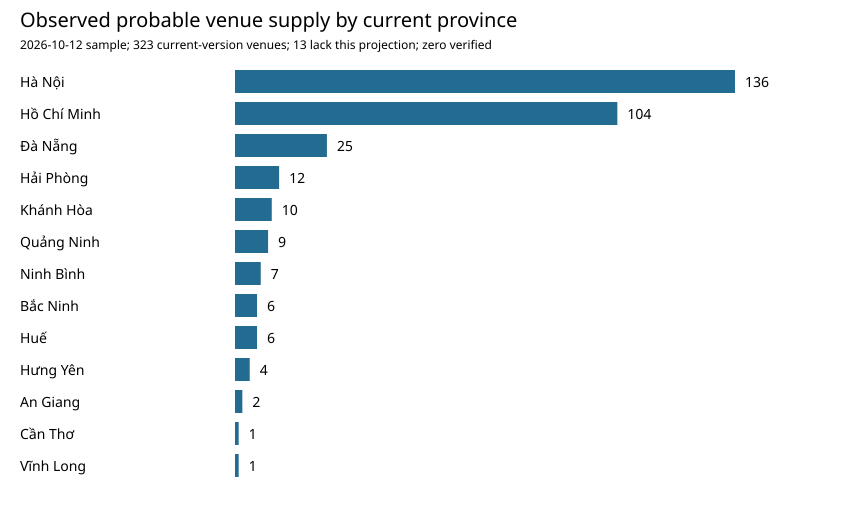
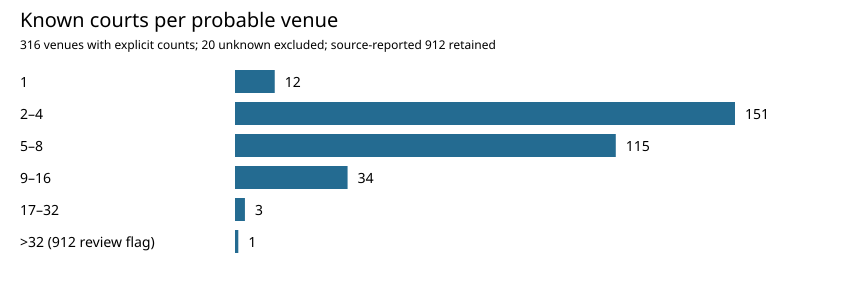

# Gold EDA

Analysis of validated generation **2026-10-12T05:30:05.213076Z**, generated from source observations through **2026-10-12T05:28:49.458043Z**. All listed datasets were fully queried, with no sampling or source-table writes. Instants are UTC; new Gold publication/collection calendar dates use Asia/Ho_Chi_Minh.

## Thirteen Gold datasets queried

| Dataset | Full rows | Delta version | Duplicate grain keys |
| --- | --- | --- | --- |
| `court_supply_by_admin_version_v2` | 22 | 5 | 0 |
| `social_engagement_daily_v1` | 167 | 5 | 0 |
| `social_intent_daily_v2` | 243 | 5 | 0 |
| `social_comment_analytics_daily_v1` | 6 | 5 | 0 |
| `social_activity_by_admin_version_daily` | 162 | 5 | 0 |
| `national_location_coverage_v1` | 983 | 5 | 0 |
| `venue_community_feedback_weekly_v1` | 14 | 5 | 0 |
| `location_term_usage_monthly_v1` | 94 | 5 | 0 |
| `venue_discovery_trends_v1` | 24 | 5 | 0 |
| `location_market_research_monthly_v1` | 99 | 5 | 0 |
| `court_supply_by_location` | 8 | 62 | 0 |
| `social_activity_daily` | 47 | 62 | 0 |
| `location_market_signal_snapshot` | 8 | 65 | 0 |

New Gold contributes 1,814 aggregate rows; legacy v1 contributes 63. These rows represent multiple projections/grains, not additional market entities. All ten new tables are populated and matched ClickHouse at capture; v1 supply/activity are absent from ClickHouse, while v1 market snapshot matches its eight served rows.

## Court supply and concentration

At the sole materialized supply date, 2026-10-12: 336 probable venues, zero verified venues; known counts on 316, unknown on 20, known court total 2,617. Courts per known-count venue mean=8.28, median=4, p95=12, max=912. Coverage=94.05%. Neither 20 unknown counts nor the 14 unverified canonical venues are added as courts. All eligible venues have unknown operating status. Province resolution in at least one version covers 328/336; eight fully unresolved venues carry 39 known courts. Current-version projections cover 323 venues, leaving five resolved only in the old version. Current province rows cover 13/34 units; historical rows cover seven/63. These are observed reference coverage counts, not national market capture rates; do not add old and current projections.

| Current province | Probable venues | Known courts | Known-count venues | Court-count coverage |
| --- | --- | --- | --- | --- |
| Hà Nội | 136 | 1587 | 116 | 85.29% |
| Hồ Chí Minh | 104 | 562 | 104 | 100.00% |
| Đà Nẵng | 25 | 118 | 25 | 100.00% |
| Hải Phòng | 12 | 64 | 12 | 100.00% |
| Khánh Hòa | 10 | 45 | 10 | 100.00% |
| Quảng Ninh | 9 | 48 | 9 | 100.00% |
| Ninh Bình | 7 | 35 | 7 | 100.00% |
| Bắc Ninh | 6 | 22 | 6 | 100.00% |
| Huế | 6 | 24 | 6 | 100.00% |
| Hưng Yên | 4 | 30 | 4 | 100.00% |
| An Giang | 2 | 16 | 2 | 100.00% |
| Cần Thơ | 1 | 4 | 1 | 100.00% |
| Vĩnh Long | 1 | 3 | 1 | 100.00% |

Hà Nội + Hồ Chí Minh contain 240/336 venues (71.43%) and 2,149/2,617 reported known courts (82.12%). The court concentration is heavily affected by the 912-court source value in Hà Nội; venue concentration is more robust. Counts of unrepresented provinces stay unavailable. The price fields are NULL on every supply group. A histogram of the 316 eligible known counts retains the extreme value in an explicit >32 bin.

`venue_discovery_trends_v1` has 24 rows, all in October 2026: NATIONAL discovery=336 probable venues and 14 unverified candidates; zero verified discoveries. First observations begin October 5. This is lake discovery, not venue opening. A one-month inventory is supported; a growth curve or supply time series is not.

## Social activity, engagement and publication coverage

`social_activity_by_admin_version_daily` counts 356 posts, five comments and two replies in NATIONAL scope across 55 publication dates and 22 populated publication months. Of 356 posts, 303 (85.11%) are published in October 2026. The old publication tail is sparse; absent dates/months are unobserved, not demonstrated zero activity. Publication ranges are August 5, 2024–October 12, 2026 in Vietnam time.

| Platform | Relevant posts | Latest cumulative views | Latest likes | Source-reported comments |
| --- | --- | --- | --- | --- |
| threads | 51 | NULL | 9450 | NULL |
| youtube | 285 | 1098210 | 3437 | 94 |

Gold engagement includes 336 explicitly relevant posts (285 videos + 51 Threads posts) and excludes 17 irrelevant + three uncertain videos. It chooses one valid snapshot per content. YouTube views=1,098,210, likes=3,437 over 283/285 available videos, source-reported comments=94; Threads likes=9,450. Do not combine video views and Threads likes into total engagement. Shares, median_engagement and high-engagement fields are NULL throughout. Publication-cohort cumulative views are not historical daily view accrual.

The latest observed metric period is October 7–12, 2026 only. Geography bars must use one version; province sums can exceed NATIONAL totals because one content can mention several provinces. UNRESOLVED and NATIONAL are separate scopes. Averaging daily averages is invalid: recompute `sumOrNull(total_likes)/nullIf(sum(posts_with_likes),0)`.

## Intent and community diagnostics

NATIONAL intent totals: GENERAL_DISCUSSION=185, EVENT_TOURNAMENT=87, PRICE_INQUIRY=62, SUPPLY_ADVERTISEMENT=19, SEEK_PLAYERS=6, SEEK_COURT=3, VENUE_FEEDBACK=1. Labels overlap. SEEK_COURT consists of two Threads posts (one Hà Nội, one Hồ Chí Minh) and one geographically unresolved YouTube comment with uncertain relevance. BOOKING_INTENT/CAPACITY_COMPLAINT have no eligible rows. Do not label these as confirmed requests/bookings or measured unmet demand.

`social_comment_analytics_daily_v1` has six rows: three national publication-day groups plus three unresolved groups. NATIONAL collected comments=5, replies=2, relevant=0, sentiment-classified=0, resolved own geography=0. Thus sentiment counts/shares and reported-comment allocation remain NULL. Its court-seeking relevant count is zero while the intent table has one uncertain SEEK_COURT comment: this is an explicit eligibility difference (comments analytics requires true relevance; intent excludes only false relevance), not a broken aggregate.

`venue_community_feedback_weekly_v1` has 14 venue/week rows over nine venues, 15 mentioning-post memberships, zero comment memberships, zero classified feedback evidence. Positive/negative/facility/price/service feedback are NULL. One Silver negative-feedback post does not imply identifiable venue feedback in this table. Ratings and complaint leaderboards are unsupported.

## Geographic terms, collection coverage and supply/social pairs

`location_term_usage_monthly_v1` has 94 rows: actual raw location spans grouped by publication month, platform, term and one canonical target. `mention_count` is spans; `unique_content_count` deduplicates within a term group only. Term shares use the location/platform/month span denominator; never add per-term unique counts or average shares across months. Place-name usage is supported; changing market shares/populations is not.

`national_location_coverage_v1` has 983 source/location/day rows: 857 MISSING, 126 PARTIAL, zero COMPLETE/FAILED. Planned queries and query-success rates are NULL on all 983. MISSING is absent target-query evidence, not absent market activity. National accepted/resolved ratios describe allowed observation lineage, not distinct post-geography rates or market penetration. Only ten national source/day groups exist; the 973 province rows must not be added to them.

`location_market_research_monthly_v1` has 99 rows; 77 (77.78%) lack historical supply snapshots. Only the October 2026 period has observed-as-of supply (22 groups). For the captured 13 supply provinces, only six have social observations; seven have no observed content. Raw diagnostics: Hà Nội 136 venues / 103 relevant post memberships / one SEEK_COURT post; Hồ Chí Minh 104 / 36 / one; Đà Nẵng 25 / 14 / zero. These pair a current supply sample with collected publication cohorts; no correlation, demand gap, occupancy or player-population inference is justified. Keep NO_CONTENT_OBSERVED separate from zero measured market activity.

## Legacy v1 differences and consistency

v1 `court_supply_by_location`: eight locations, summed venue_count=285 and known_court_count=2,342; narrower alias/geographic scope differs from v2 (336/2,617). It has no admin_version, verification partition or national distinct row. v1 `social_activity_daily`: 47 location/day rows, 51 post memberships, summed likes=6,811, engagement_total=7,756; it uses Threads native likes+replies+reposts+quotes and UTC publication dates. First UTC date 2024-08-04 becomes 2024-08-05 in new VN-date tables. NULL native metrics are zero-filled by legacy implementation, so legacy engagement is not interchangeable with new nullable platform semantics.

v1 `location_market_signal_snapshot`: eight rows with **snapshot/window end 2026-10-07**, window September 8–October 7 (30 days), despite generated_at on October 12. Four social post memberships, 14 legacy interactions and current legacy supply are present. Normalized per-venue fields are source-specific sample ratios, not occupancy or demand. Latest build time is not snapshot freshness.

Independent new checks: 1,954/1,954 pass. Independent v1 checks: 347/347 pass. All ten new tables also reproduce exactly using production formulas; this supplementary replay is not independent validation. All 29 manifest input/output versions and content digests match; all 17,093 rows across the 32 requested datasets validate their contracts. See [cross_layer_findings.md](cross_layer_findings.md) for scope rules and limitations. Full field NULL rates, empty-value counts, numeric quantiles, categorical frequencies and time bounds are in [profiles.json](evidence/profiles.json); exact findings and checks are in [findings.json](evidence/findings.json). Read logic: [read_snapshot.py](code/read_snapshot.py), [analyze.py](code/analyze.py).
