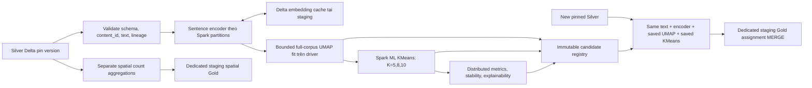

# Spark ML từ Silver — runbook và bàn giao

Provincial Ridge forecasting được bổ sung ngày 11-11-2026 với yêu cầu benchmark
riêng: xem [Ridge runbook](PROVINCIAL_RIDGE.md) và
[kết quả triển khai](PROVINCIAL_RIDGE_REPORT.md). Báo cáo clustering bên dưới giữ
nguyên phạm vi lần chạy 29-10-2026.

Cập nhật 29-10-2026, branch `model`. Pipeline tạo **candidate**, chưa chốt K=8,
chưa promote production. Không sửa crawler, Bronze hay Silver.

## Kiến trúc đã triển khai



UMAP không phải Spark transformer: numeric embeddings được collect **sau kiểm tra
giới hạn**, tối đa 10.000 dòng và 256 MB theo ước tính array working set ×8.
Không tự sampling, PCA hay bỏ UMAP khi vượt giới hạn. Giới hạn byte không phải
cam kết total RSS vì UMAP/Numba/graph còn có overhead. Reference coordinates được
lưu Delta version 0 để inference lại training posts giữ đúng tọa độ fit. Với bài
mới, mỗi executor load cùng UMAP và transform từng dòng; cách này chậm hơn batch
nhưng tránh phụ thuộc thứ tự/batch của UMAP. Không fit lại khi inference.

Chỉ `text_normalized` đi vào encoder, sau NFKC và collapse whitespace. Intent/topic
chỉ join 1:1 sau prediction để hậu kiểm. Không join evidence 1–N vào corpus.
Loader reject null/duplicate `post_id` hoặc `content_id`, schema/version sai,
source/lineage thiếu; loại text rỗng và báo số lượng. Text trùng giữa content IDs
khác nhau chỉ được ghi nhận, không âm thầm thay đổi population benchmark.

## Audit thực tế

S3 read-only recheck ngày 29-10 đã thử cả bốn bảng; **BLOCKED**: credential process
báo phiên AWS hết hạn. Báo cáo 44/44 cũ không được coi là kiểm chứng hiện tại.
Chi tiết lần thử: `.local/ml/audit-s3-recheck.json`, log `/tmp/dsp-ml-audit.log`.

Audit Spark trực tiếp bản local immutable bootstrap reference
`.local/s3-snapshots/20261028T064025Z/lakehouse`:

| Silver table | Grain/key | Delta version | Rows | Duplicate key | Partition |
|---|---|---:|---:|---:|---|
| social_posts | post / post_id; content_id cũng unique | 35 | 649 | 0 | none |
| social_intent_evidence | evidence / evidence_id | 35 | 949 | 0 | none |
| social_geo_mentions | mention / mention_id | 35 | 450 | 0 | none |
| court_venues | canonical venue / venue_id | 35 | 373 | 0 | none |

Các path nằm tại `silver/intelligence/<table>`. Schema đã đọc trực tiếp và lưu
trong `.local/ml/local-silver-audit.json`; row `schema_version="3"`, khác
`processing_version="requirements-v1.0-r5"`. Loader lấy supported schema version
từ contract hiện có. Đây không phải Dataset V1.

Social: 598 YouTube + 51 Threads; 649 content IDs duy nhất, không null lineage,
không empty text, không bị gắn duplicate, nhưng có **9 nhóm text NFKC trùng**.
Không thấy marker `synthetic` trong lineage IDs; điều này **không chứng minh**
không có dữ liệu mô phỏng. Provenance của run giữ `unknown`, không tự gắn `real`.
Repo đã có source-policy gate phân biệt synthetic-only/real trong S3 writer;
pipeline ML không thay đổi hay tự cấp quyền qua gate này.

Đối chiếu V3: **649 ≠ 6.490 posts**. Venues cùng count 373 nhưng snapshot này có
**0 tọa độ hợp lệ**, khác 229 trong benchmark. Chưa có notebook/Parquet V3,
fitted encoder/UMAP hoặc Colab assignment export để xác minh snapshot/protocol.
Tất cả metric hiện tại mang `NOT_DIRECTLY_COMPARABLE`. Cần kiểm tra lại S3 sau
reauthentication; các số local không khẳng định trạng thái S3 hiện tại.

Không có MLflow runtime sẵn trong project; dùng registry manifest và boto3 đã có,
không thêm MLflow. Spark session/Delta/S3A tái sử dụng runtime của repo:
Spark 4.0.2, Delta 4.0.1, Hadoop 3.4.1, Scala 2.13, Java 17;
`DSP_SPARK_MASTER` hỗ trợ local hoặc Spark cluster, không chỉ local mode.

## Cài đặt và CLI

```bash
.venv/bin/python -m pip install torch==2.6.0 --index-url https://download.pytorch.org/whl/cpu
.venv/bin/python -m pip install -r pipelines/spark/requirements-ml.txt
export PYTHONPATH="$PWD/pipelines/spark/src:$PWD/apps/collector/src"
export PYSPARK_PYTHON="$PWD/.venv/bin/python"
export OPENBLAS_NUM_THREADS=1 OMP_NUM_THREADS=1 NUMBA_NUM_THREADS=1
export HF_HOME="$PWD/.local/ml/huggingface"
# Local execution only; do not use loopback as the advertised address on a cluster.
export SPARK_LOCAL_IP=127.0.0.1
export PYSPARK_SUBMIT_ARGS='--driver-memory 2g pyspark-shell'
```

ML dependencies là opt-in requirements riêng, không thay core `poetry.lock`.
Encoder cần weights/cache có sẵn hoặc outbound Hugging Face trên mỗi executor.
Có thể đặt `HF_HUB_OFFLINE=1` sau prefetch. Pin model SHA, `max_seq_length`, batch
size, device, normalization và encoder version trong
[`demand_minilm.json`](../../configs/ml/demand_minilm.json). MiniLM SHA được kiểm
tra từ [model API chính chủ](https://huggingface.co/api/models/sentence-transformers/paraphrase-multilingual-MiniLM-L12-v2).
Đổi sang một sentence encoder khác bằng config/revision/dimension; raw BERT hoặc
PhoBERT cần adapter/pooling đã benchmark, không tự coi default pooling là baseline.

Tạo snapshot descriptor từ [`snapshot.example.json`](../../configs/ml/snapshot.example.json):
điền path thực tế, Delta version, dataset ID, provenance, generation. Không tự đọc
latest cho từng bảng trong cùng một generation. Với managed lakehouse, resolve
`control/current.json` một lần rồi lấy `paths`/`output_versions` từ generation
manifest đã VALIDATED; pin descriptor trong suốt run. Không tự refresh pointer.

```bash
# Audit read-only, path/profile truyền từ môi trường hoặc operator.
.venv/bin/python -m dsp_spark.jobs.batch.demand_clustering \
  --profile "$DSP_S3_PROFILE" audit --lakehouse-base "$DSP_LAKEHOUSE_BASE_URI" \
  --report .local/ml/s3-audit.json

# Mặc định dry-run: đọc/validate Silver và config, không encode/train/publish.
.venv/bin/python -m dsp_spark.jobs.batch.demand_clustering train \
  --snapshot .local/ml/snapshot.json --config configs/ml/demand_minilm.json \
  --registry .local/ml/staging/registry --cache-root .local/ml/staging/cache \
  --report .local/ml/train-plan.json

# Execute chỉ tạo candidate staging. Report trả run_id.
.venv/bin/python -m dsp_spark.jobs.batch.demand_clustering train \
  --snapshot .local/ml/snapshot.json --config configs/ml/demand_minilm.json \
  --registry .local/ml/staging/registry --cache-root .local/ml/staging/cache \
  --execute --report .local/ml/training.json

# RUN_ID lấy từ training report. Bỏ --publish nếu chỉ muốn kiểm tra inference.
.venv/bin/python -m dsp_spark.jobs.batch.demand_clustering infer \
  --snapshot .local/ml/snapshot.json --registry .local/ml/staging/registry \
  --cache-root .local/ml/staging/cache --run-id "$RUN_ID" --k 8 \
  --execute --publish --output-root .local/ml/staging/inference \
  --report .local/ml/inference.json

# Rollback riêng bảng ML staging; không VACUUM hoặc xóa historical files.
.venv/bin/python -m dsp_spark.jobs.batch.demand_clustering rollback-gold \
  --output-root .local/ml/staging/inference --version 0 --execute
```

S3 writes còn cần `--allow-cloud-write` sau khi được operator cho phép và runtime
identity **không phải Root**. Mọi write root phải chứa path segment `staging` và
không chứa/bao phủ source Silver. Không có CLI write production hoặc promotion.
Tên `staging` là guard bổ sung; IAM vẫn phải giới hạn prefix thực sự.

Inference incremental hỗ trợ `--after <ISO timestamp có timezone>` trên
`last_seen_at > watermark`, snapshot vẫn phải pin. Operator chỉ advance watermark
sau successful publish. Dùng overlap watermark khi nguồn có equal timestamps/late
arrivals; MERGE chống duplicate. Không có managed automatic watermark/CDF consumer.

Training hỗ trợ `--baseline-assignments <versioned parquet>` có unique `content_id`
và `cluster_id`: báo overlap/ARI, không tự xác nhận direct comparability.
`--lexical-ablation` chạy hashed TF-IDF + KMeans như evaluation riêng.

## Artifact registry và Gold contract

```text
<registry>/runs/<run_id>/
  reservation.json             # RUNNING; incomplete runs cannot be loaded
  umap.joblib                  # operator-owned trusted pickle; SHA256 verified
  umap_reference/              # Delta version 0, content_id + text hash + fitted coords
  k5|k8|k10/spark_model/        # Spark KMeansModel
  manifest.json                # committed last; config, centroids, encoder/revision,
                               # versions, dataset fingerprint, provenance,
                               # evaluation, explanation metadata and resource plan
```

Run ID reservation/object creation là exclusive; không overwrite artifact cũ.
Manifest `candidate` là output mặc định. `validated` nghĩa là đã qua operator
review; lần bàn giao này chưa có validation/promotion record và không tự chuyển
state. `production` dành cho deployment process được phê duyệt riêng, loader hiện
từ chối state đó. Registry không thay thế IAM, audit trail hay release review.
Chỉ load registry đáng tin vì joblib là executable serialization. Runtime mismatch
và checksum UMAP sai fail trước transform. Cluster name giữ null/`UNREVIEWED`, có
interpretation version; không tự suy diễn nhu cầu. Representative posts mặc định
tắt; bật bằng config sẽ giữ ID/distance và **withhold toàn bộ text** để che PII.
c-TF-IDF và label lift là mô tả hậu nghiệm, không phải SHAP/ground truth.

Embedding cache key `(content_id, text_hash_ml, encoder_key)`. Encoder key gồm
model SHA/config, text preprocessing version và phiên bản thư viện encoder chính.
Text/encoder thay đổi tạo cache entry mới. Cooperative single writer trên cache
và từng Gold table; Delta concurrency conflict được trả lỗi, không âm thầm retry.

Dataset fingerprint là SHA256 của snapshot descriptor, row count, text version và
distributed sums của các chunk row SHA256; order-independent, không phải exact
cryptographic multiset proof. Delta URI + pinned version là định danh snapshot
authoritative. Không chia train/test có shared text/duplicate groups nếu sau này
thêm held-out evaluation; hiện stability là conditional refit, không phải đánh
giá encoder/UMAP ngoài mẫu.

Gold chỉ tại `<output-root>/gold/demand_cluster_assignments_v1`, key
`(content_id, model_version, source_snapshot_id)`. Contract máy đọc:
[`demand_cluster_assignments_v1.schema.json`](../../contracts/data/gold/demand_cluster_assignments_v1.schema.json).
Columns gồm content/model/cluster, UTC inference timestamp, snapshot ID, Silver
path/version/generation, provenance và Euclidean distance tới centroid trong
**UMAP space**. Distance không phải confidence/probability. Insert-only MERGE giữ
kết quả snapshot cũ và timestamp đầu tiên; assignment mâu thuẫn cho cùng key bị
reject. Một Silver snapshot mới tạo namespace assignment mới. Reader phải chọn
model + source snapshot rõ ràng. Rollback dùng Delta RESTORE version đã ghi nhận;
first-write rollback chọn reader version thay vì xóa bảng.

## Evaluation và scale

Cosine silhouette dùng Spark `ClusteringEvaluator(distanceMeasure="cosine")` trên
original normalized embedding, không dùng default squared Euclidean. CH dùng
distributed sufficient statistics trên **UMAP 15D Euclidean**, collect O(K×d).
Stability refit KMeans qua 5 seeds và hash-selected subsamples target 80%, giữ cố
định encoder và UMAP; so ARI với full-data fit trên phần overlap. Báo cả số dòng
thực tế mỗi subsample. Đây không phải kiểm tra stability toàn pipeline embedding
và UMAP. Xem [Spark evaluator](https://spark.apache.org/docs/4.0.1/api/python/reference/api/pyspark.ml.evaluation.ClusteringEvaluator.html)
và [UMAP API](https://umap-learn.readthedocs.io/en/latest/api.html).

Mặc định 4 hash partitions theo content_id khi encode, bounded batches 32; local
test dùng local[2], driver JVM 2 GiB, Python/encoder ở ngoài heap. Host 8 GiB chạy
được corpus 649 bài; không suy ra cluster capacity từ số này. Đề xuất ban đầu
driver 4 GiB JVM + ít nhất 2 GiB overhead, executor 2 GiB JVM + 2 GiB overhead,
1 concurrent encoder task/executor, 1 CPU thread cho BLAS/Numba; đo RSS thực tế
trước tăng concurrency. Model weights được load một lần mỗi partition. Preinstall
cùng Python/dependencies/source package, Java, connector/profile và model cache
trên mọi worker. Đặt `DSP_SPARK_MASTER`, executor resources và các
`spark.executorEnv.*` qua submit configuration. Không tự tạo cluster/service.
Các bước còn lại distributed: Delta reads/merges, normalization, joins,
KMeans fit/transform, cosine silhouette, CH/ARI aggregations, label/token counts.
Explanation chỉ collect bounded top-N mỗi cluster. Chưa đo multi-host execution.

## Spatial và trend

`spatial_supply_demand.py` là job riêng: canonical venues + geo mentions + unique
social posts → counts theo admin geography → Gold staging. Count distinct
content IDs trong mỗi địa phương; không dùng số evidence làm số bài.
Input JSON có `post_snapshot` cùng format trên, `venues` và `mentions` mỗi mục có
`path` và pinned `version`:

```bash
.venv/bin/python -m dsp_spark.jobs.batch.spatial_supply_demand \
  --inputs .local/ml/spatial-inputs.json --admin-column old_province_id \
  --output-root .local/ml/staging/spatial --report .local/ml/spatial.json
```

Mặc định dry-run; `--execute` mới ghi bảng counts riêng. KDE 25 km chỉ là reference
trong benchmark được cung cấp; KDE/Moran/LISA/Gi*/Spearman chưa chạy ở đây, không
được đóng gói giả làm Spark ML model. Cần protocol/grid/weights/CRS và coordinates
phù hợp trước khi thêm statistical outputs. Trend chỉ có `TrendForecaster`
interface; chưa chọn thuật toán, fit, hay tạo metric.

`interested_post_count` ở job counts chỉ là proxy số bài có geo mention thuộc
địa phương; không phải số booking hoặc ground truth nhu cầu. Gold spatial dùng
`admin_unit_id` + `admin_geography` + `snapshot_id` làm key ổn định giữa các cấp.

## Kết quả và file bàn giao

Xem [báo cáo thực thi](REPORT.md) và [aggregate evidence](evidence.json).
Commands kiểm thử:

```bash
PYTHONPATH="$PYTHONPATH:$PWD/pipelines/spark/test" .venv/bin/python \
  -m unittest discover -v -s pipelines/spark/test -p 'test_demand_ml*.py'
.venv/bin/ruff check pipelines/spark/src/dsp_spark/ml \
  pipelines/spark/src/dsp_spark/jobs/batch/{demand_clustering,spatial_supply_demand}.py \
  pipelines/spark/test/test_demand_ml*.py
```

Files mới: `dsp_spark/ml/{config,data,embedding,reduction,evaluation,explain,registry,
pipeline,publish,extensions}.py`, package initializer, hai batch jobs trên,
`configs/ml/{demand_minilm,snapshot.example}.json`, optional ML requirements,
Gold JSON contract, `test_demand_ml.py`, `test_demand_ml_delta.py`, tài liệu/evidence.
Files sửa: `.gitignore` cho phép track docs ML và `pipelines/spark/README.md` thêm link.
